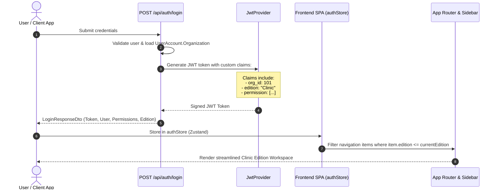

# CURASPHERE CLINIC EDITION — ARCHITECTURE SPECIFICATION
**Document ID:** `ARCH-CE-001`  
**Version:** 1.0.0  
**Status:** Approved Architecture Draft  
**Scope:** Three-Tier Product Line Architecture (Hospital, Clinic, Enterprise) with immediate focus on Clinic Edition.

---

## 1. Executive Architectural Vision

CuraSphere is transitioning from a monolithic single-facility Hospital Management System (HMS) into an **edition-aware modular healthcare platform** supporting three commercial editions from a unified, maintainable codebase:

```
                              ┌──────────────────────────────────┐
                              │     CuraSphere Core Platform     │
                              │ (Shared Clean Architecture Core) │
                              └─────────────────┬────────────────┘
                                                │
         ┌──────────────────────────────────────┼──────────────────────────────────────┐
         ▼                                      ▼                                      ▼
┌──────────────────────────────┐ ┌──────────────────────────────┐ ┌──────────────────────────────┐
│       CLINIC EDITION         │ │       HOSPITAL EDITION       │ │      ENTERPRISE EDITION      │
│     (Immediate Scope)        │ │     (Preserved Baseline)     │ │        (Future Ready)        │
├──────────────────────────────┤ ├──────────────────────────────┤ ├──────────────────────────────┤
│ • Outpatient Appointments    │ │ • Inpatient (IPD) Wards      │ │ • Multi-Facility Hierarchy   │
│ • Doctor Availability Slots  │ │ • Bed Allocation Grid        │ │ • Central Clinician Registry │
│ • Reception Token Queue      │ │ • Emergency Room (ER) Triage │ │ • Cross-Facility MRN Search  │
│ • Consultation Workspace     │ │ • Surgery Operating Theaters │ │ • Enterprise Consolidated BI │
│ • Rx Prescriptions & History │ │ • ICU Telemetry & Vitals     │ │ • Inter-Clinic Referrals     │
│ • POS Consultation Billing   │ │ • Complex Inpatient Billing  │ │ • Multi-Tenant RBAC & SSO    │
│ • Clinic Daily KPI Dashboard │ │ • Department Ward Stations   │ │ • Central Billing & Claims   │
└──────────────────────────────┘ └──────────────────────────────┘ └──────────────────────────────┘
```

### Core Architecture Principles
1. **Preserve Hospital Baseline:** The existing hospital modules ([`IPD`](file:///c:/Users/LENOVO/Downloads/-CuraSphere-HMS-DevelopbyUzaii-main/-CuraSphere-HMS-DevelopbyUzaii-main/frontend/src/features/ipd/pages/IPDPage.tsx), [`Emergency`](file:///c:/Users/LENOVO/Downloads/-CuraSphere-HMS-DevelopbyUzaii-main/-CuraSphere-HMS-DevelopbyUzaii-main/frontend/src/features/emergency/pages/EmergencyPage.tsx), [`Surgery`](file:///c:/Users/LENOVO/Downloads/-CuraSphere-HMS-DevelopbyUzaii-main/-CuraSphere-HMS-DevelopbyUzaii-main/frontend/src/features/surgery/pages/SurgeryPage.tsx), [`ICU`](file:///c:/Users/LENOVO/Downloads/-CuraSphere-HMS-DevelopbyUzaii-main/-CuraSphere-HMS-DevelopbyUzaii-main/frontend/src/features/icu/pages/ICUPage.tsx)) remain completely intact, testable, and functional.
2. **No Speculative Rebuilding:** The solution leverages existing domain entities ([`Patient`](file:///c:/Users/LENOVO/Downloads/-CuraSphere-HMS-DevelopbyUzaii-main/-CuraSphere-HMS-DevelopbyUzaii-main/backend/CuraSphere.Domain/Entities/Patient.cs), [`Doctor`](file:///c:/Users/LENOVO/Downloads/-CuraSphere-HMS-DevelopbyUzaii-main/-CuraSphere-HMS-DevelopbyUzaii-main/backend/CuraSphere.Domain/Entities/HR.cs), [`Appointment`](file:///c:/Users/LENOVO/Downloads/-CuraSphere-HMS-DevelopbyUzaii-main/-CuraSphere-HMS-DevelopbyUzaii-main/backend/CuraSphere.Domain/Entities/Clinical.cs), [`OpdToken`](file:///c:/Users/LENOVO/Downloads/-CuraSphere-HMS-DevelopbyUzaii-main/-CuraSphere-HMS-DevelopbyUzaii-main/backend/CuraSphere.Domain/Entities/Clinical.cs), [`Invoice`](file:///c:/Users/LENOVO/Downloads/-CuraSphere-HMS-DevelopbyUzaii-main/-CuraSphere-HMS-DevelopbyUzaii-main/backend/CuraSphere.Domain/Entities/Financial.cs)) and only introduces new tables where functional gaps require them.
3. **Defense-in-Depth Authorization:** Navigation hiding is treated purely as UI ergonomics. Backend API authorization ([`HasPermissionAttribute`](file:///c:/Users/LENOVO/Downloads/-CuraSphere-HMS-DevelopbyUzaii-main/-CuraSphere-HMS-DevelopbyUzaii-main/backend/CuraSphere.Api/Middleware/HasPermissionAttribute.cs)) independently validates permissions regardless of frontend state.
4. **Tenant Organization Data Isolation:** Multi-clinic isolation is enforced at the ORM layer using EF Core Global Query Filters on `OrganizationId`, preventing accidental or malicious cross-organization data leakage.

---

## 2. Edition Resolution and Selection Mechanism

### Organization-Level Edition Configuration
An organization entity (`ClinicOrganization`) defines the operating mode of the deployment:

```csharp
public enum ProductEdition
{
    Clinic = 1,
    Hospital = 2,
    Enterprise = 3
}
```

### Edition Determination Workflow


### Claim Specification
Every issued JWT includes:
- `org_id`: Numeric identifier of the clinic organization.
- `edition`: String name of the active edition (`Clinic`, `Hospital`, `Enterprise`).
- `permission`: Array of scoped permissions (`patients.read`, `clinic.consultation`, etc.).

---

## 3. Organization Isolation and Multi-Tenancy Architecture

### Current Gap Identified During Audit
In the existing codebase:
- Entities ([`Patient`](file:///c:/Users/LENOVO/Downloads/-CuraSphere-HMS-DevelopbyUzaii-main/-CuraSphere-HMS-DevelopbyUzaii-main/backend/CuraSphere.Domain/Entities/Patient.cs), [`Appointment`](file:///c:/Users/LENOVO/Downloads/-CuraSphere-HMS-DevelopbyUzaii-main/-CuraSphere-HMS-DevelopbyUzaii-main/backend/CuraSphere.Domain/Entities/Clinical.cs), [`Invoice`](file:///c:/Users/LENOVO/Downloads/-CuraSphere-HMS-DevelopbyUzaii-main/-CuraSphere-HMS-DevelopbyUzaii-main/backend/CuraSphere.Domain/Entities/Financial.cs)) inherit from `BaseEntity` which only contains audit timestamps.
- `BranchFacility` exists as an isolated table with zero foreign keys.
- Queries in [`PatientService.cs`](file:///c:/Users/LENOVO/Downloads/-CuraSphere-HMS-DevelopbyUzaii-main/-CuraSphere-HMS-DevelopbyUzaii-main/backend/CuraSphere.Infrastructure/Services/PatientService.cs) and [`AppointmentService.cs`](file:///c:/Users/LENOVO/Downloads/-CuraSphere-HMS-DevelopbyUzaii-main/-CuraSphere-HMS-DevelopbyUzaii-main/backend/CuraSphere.Infrastructure/Services/AppointmentService.cs) query all database rows without organization filtering.

### Architectural Remedy: `ITenantScopedEntity` & Global Query Filters
1. Define tenant interface:
   ```csharp
   public interface ITenantScopedEntity
   {
       long OrganizationId { get; set; }
   }
   ```
2. Tenant context resolution service:
   ```csharp
   public interface ICurrentTenantService
   {
       long OrganizationId { get; }
       ProductEdition Edition { get; }
   }
   ```
3. In [`CuraSphereDbContext.cs`](file:///c:/Users/LENOVO/Downloads/-CuraSphere-HMS-DevelopbyUzaii-main/-CuraSphere-HMS-DevelopbyUzaii-main/backend/CuraSphere.Infrastructure/Persistence/CuraSphereDbContext.cs):
   ```csharp
   protected override void OnModelCreating(ModelBuilder modelBuilder)
   {
       base.OnModelCreating(modelBuilder);

       // Enforce tenant isolation for all tenant-scoped entities
       foreach (var entityType in modelBuilder.Model.GetEntityTypes())
       {
           if (typeof(ITenantScopedEntity).IsAssignableFrom(entityType.ClrType))
           {
               modelBuilder.Entity(entityType.ClrType)
                   .HasQueryFilter(ConvertFilterExpression(entityType.ClrType, _currentTenantService.OrganizationId));
           }
       }
   }
   ```
4. Automatic Tenant Assignment in `SaveChangesAsync`:
   The `CuraSphereDbContext` interceptor stamps `OrganizationId = _currentTenantService.OrganizationId` on every newly added `ITenantScopedEntity`, guaranteeing cross-tenant data leakage is prevented at runtime.

---

## 4. Frontend Edition-Aware Navigation Architecture

### Modular NavItem Schema
The navigation configuration in [`frontend/src/components/layout/Sidebar.tsx`](file:///c:/Users/LENOVO/Downloads/-CuraSphere-HMS-DevelopbyUzaii-main/-CuraSphere-HMS-DevelopbyUzaii-main/frontend/src/components/layout/Sidebar.tsx) is updated from ad-hoc strings to typed edition metadata:

```typescript
export type EditionType = "clinic" | "hospital" | "enterprise";

export interface NavItem {
  label: string;
  path: string;
  icon: React.ReactNode;
  permission?: string;
  roles?: string[];
  editions: EditionType[]; // Explicitly declares applicable editions
  section: "core" | "clinical" | "finance" | "admin" | "hospital_only";
}
```

### Clinic Navigation Rules
When `activeEdition === "clinic"`:
- **Visible Modules:**
  - Overview: `/dashboard` (Clinic Edition KPI Dashboard)
  - Clinic Reception: `/appointments` (Calendar & Slots), `/opd` (Fast-track queue), `/patients` (Directory & Quick Intake)
  - Medical Practice: `/consultations` (Doctor Workspace & EMR), `/doctors` (Staff Directory & Availability)
  - Finance: `/billing` (Consultation Invoicing & Thermal Receipts), `/payments` (Cashier register)
  - Settings: `/clinic/settings` (Clinic Profile, Schedule Config, Timings)
- **Filtered Out / Suppressed:**
  - `/ipd` (Inpatient Wards & Beds)
  - `/emergency` (Emergency Triage P1–P3)
  - `/surgery` (OT Scheduling)
  - `/icu` (ICU Telemetry)

---

## 5. Extensibility to Enterprise Edition

The design provides clean upgrade paths to Enterprise capabilities without refactoring Clinic or Hospital modules:
1. **Multi-Clinic Hierarchies:** An `EnterpriseOrganization` acts as parent to multiple `ClinicOrganization` entities via `ParentOrganizationId`.
2. **Central Clinician Pool:** `Doctor` records link to `OrganizationId`, but can be mapped to multiple clinics via a cross-facility mapping table (`DoctorFacilityAssignment`).
3. **Federated Patient Search:** Enterprise Administrator tokens carry a claim `cross_facility_search = true` which bypasses tenant query filters to search records across multiple facilities.

---

## 6. Security & Hardening Architecture

1. **Backdoor Eradication:**
   - Eliminate hardcoded credential matches in [`AuthService.cs`](file:///c:/Users/LENOVO/Downloads/-CuraSphere-HMS-DevelopbyUzaii-main/-CuraSphere-HMS-DevelopbyUzaii-main/backend/CuraSphere.Infrastructure/Services/AuthService.cs#L118-L159).
   - Only hash-matched database credentials from `UserAccount` with `AccountStatus == "Active"` are accepted.
2. **Startup Secret Validation:**
   - In [`Program.cs`](file:///c:/Users/LENOVO/Downloads/-CuraSphere-HMS-DevelopbyUzaii-main/-CuraSphere-HMS-DevelopbyUzaii-main/backend/CuraSphere.Api/Program.cs#L41), remove fallback default keys.
   - If `JwtSettings:Secret` is null or shorter than 32 bytes, fail fast during host bootstrap:
     ```csharp
     if (string.IsNullOrWhiteSpace(jwtSecret) || jwtSecret.Length < 32)
         throw new InvalidOperationException("Fatal: JwtSettings:Secret is not securely configured.");
     ```
3. **CORS Hardening:**
   - Configure ASP.NET Core CORS policy allowing configured Vercel production and preview deployment URLs.
4. **Seed Password Permanence:**
   - Remove the restart password reset in [`DbContextSeed.cs`](file:///c:/Users/LENOVO/Downloads/-CuraSphere-HMS-DevelopbyUzaii-main/-CuraSphere-HMS-DevelopbyUzaii-main/backend/CuraSphere.Infrastructure/Persistence/Seed/DbContextSeed.cs#L221-L229). Passwords once set or rotated by administrators must never be overwritten on container restart.
