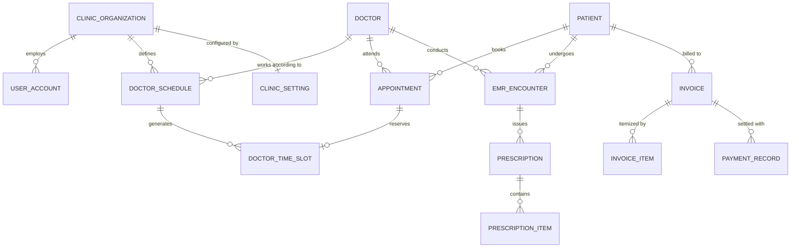

# CURASPHERE CLINIC EDITION — DATABASE IMPACT & SCHEMA EVOLUTION
**Document ID:** `DB-CE-004`  
**Version:** 1.0.0  
**Status:** Approved Database Architecture  

---

## 1. Database Architecture & Schema Conventions

CuraSphere utilizes PostgreSQL 16 managed through Entity Framework Core 8 with Code-First migrations. The database employs modular PostgreSQL schemas to segregate domain boundaries:

- `security` — Accounts, roles, claims, user sessions
- `patient` — Master patient demographics, guardians, insurance
- `hr` — Staff, doctors, departments, specializations
- `clinical` — Appointments, queues, clinical encounters, prescriptions
- `financial` — Invoices, line items, payment transactions
- `config` — Clinic and organization operational settings
- `audit` — System-wide immutable change and access logs

---

## 2. Existing Schema Entity Inventory (Reuse Baseline)

The following 18 existing entities are reused directly without breaking changes:

| Entity Name | Schema | Table Name | Reuse Strategy |
| :--- | :--- | :--- | :--- |
| `Patient` | `patient` | `patient` | Reused directly. MRN generation and duplicate checks preserved. |
| `PatientGuardian` | `patient` | `patient_guardian` | Reused directly for emergency & minor contacts. |
| `PatientInsurance`| `patient` | `patient_insurance` | Reused directly for clinic third-party coverage. |
| `BloodGroup` | `patient` | `blood_group` | Reused directly as seed lookup. |
| `MaritalStatus` | `patient` | `marital_status` | Reused directly as seed lookup. |
| `Religion` | `patient` | `religion` | Reused directly as seed lookup. |
| `Nationality` | `patient` | `nationality` | Reused directly as seed lookup. |
| `UserAccount` | `security` | `user_account` | Reused directly for clinic staff authentication. |
| `Role` | `security` | `role` | Reused directly with clinic-specific role definitions. |
| `Permission` | `security` | `permission` | Reused directly with clinic permission catalog. |
| `RolePermission` | `security` | `role_permission` | Reused directly for role mapping. |
| `UserSession` | `security` | `user_session` | Reused directly for session tracking and revocation. |
| `Doctor` | `hr` | `doctor` | Reused directly; extended with foreign key relationships. |
| `Employee` | `hr` | `employee` | Reused directly for staff details. |
| `Department` | `hr` | `department` | Reused directly (OPD, General Practice, Specialty Clinics). |
| `Specialization` | `hr` | `specialization` | Reused directly for doctor medical specialties. |
| `AuditLog` | `audit` | `audit_log` | Reused directly for HIPAA/regulatory audit logging. |
| `PatientDocument` | `patient` | `patient_document` | Reused directly for lab/radiology report attachments. |

---

## 3. Entity Modifications (Backward-Compatible Extensions)

### A. `Appointment` ([`Clinical.cs`](file:///c:/Users/LENOVO/Downloads/-CuraSphere-HMS-DevelopbyUzaii-main/-CuraSphere-HMS-DevelopbyUzaii-main/backend/CuraSphere.Domain/Entities/Clinical.cs#L6-L25))
- **Added Property:** `public long? TimeSlotId { get; set; }`
- **Navigation:** `public virtual DoctorTimeSlot? TimeSlot { get; set; }`
- **Rationale:** Connects appointments to discrete, reserved doctor time slots for conflict prevention.

### B. `EmrEncounter` ([`Clinical.cs`](file:///c:/Users/LENOVO/Downloads/-CuraSphere-HMS-DevelopbyUzaii-main/-CuraSphere-HMS-DevelopbyUzaii-main/backend/CuraSphere.Domain/Entities/Clinical.cs#L46-L62))
- **Added Property:** `public string? VitalsSummary { get; set; }` (JSON/string: BP, Pulse, Temp, Weight)
- **Added Property:** `public DateTime? FollowUpDate { get; set; }`
- **Navigation:** `public virtual ICollection<Prescription> Prescriptions { get; set; } = new List<Prescription>();`
- **Rationale:** Enables full consultation documentation and electronic prescription linkage.

---

## 4. Proposed New Entities Specification



---

### Entity 1: `ClinicOrganization`
- **Table:** `config.clinic_organization`
- **Purpose:** Represents the tenant boundary for multi-tenant clinics and multi-branch practices.
- **Primary Key:** `OrganizationId` (bigint, Identity)
- **Required Fields:**
  - `OrganizationCode` (varchar(30), Unique, e.g. `CLN-NORTH`)
  - `OrganizationName` (varchar(150), e.g. `CuraSphere Family Health Clinic`)
  - `Edition` (int: 1=Clinic, 2=Hospital, 3=Enterprise)
  - `IsActive` (boolean, default true)
  - `CreatedAt` (timestamp with time zone)
- **Constraints & Indexes:**
  - Unique Index: `(OrganizationCode)`

---

### Entity 2: `DoctorSchedule`
- **Table:** `hr.doctor_schedule`
- **Purpose:** Defines recurring weekly clinician shifts, shift timings, slot duration, and maximum quotas.
- **Primary Key:** `DoctorScheduleId` (bigint, Identity)
- **Foreign Keys:**
  - `DoctorId` (bigint, FK -> `hr.doctor`)
  - `OrganizationId` (bigint, FK -> `config.clinic_organization`)
- **Required Fields:**
  - `DayOfWeek` (smallint, 0=Sunday..6=Saturday)
  - `StartTime` (time without time zone, e.g. `09:00:00`)
  - `EndTime` (time without time zone, e.g. `13:00:00`)
  - `SlotDurationMinutes` (int, default 15, Range: 5–120)
  - `MaxPatientsPerShift` (int, default 20)
  - `IsActive` (boolean, default true)
- **Validation Rules:** `EndTime > StartTime`, `SlotDurationMinutes > 0`.
- **Unique Constraints:** `(DoctorId, DayOfWeek, StartTime)`

---

### Entity 3: `DoctorTimeSlot`
- **Table:** `clinical.doctor_time_slot`
- **Purpose:** Concrete calendar slots generated from `DoctorSchedule`. Guarantees zero double-booking.
- **Primary Key:** `TimeSlotId` (bigint, Identity)
- **Foreign Keys:**
  - `DoctorId` (bigint, FK -> `hr.doctor`)
  - `AppointmentId` (bigint, nullable, FK -> `clinical.appointment`)
  - `OrganizationId` (bigint, FK -> `config.clinic_organization`)
- **Required Fields:**
  - `SlotDate` (date)
  - `StartTime` (time without time zone)
  - `EndTime` (time without time zone)
  - `IsBooked` (boolean, default false)
- **Concurrency & Conflict Prevention:**
  - **Unique Database Constraint:** `UNIQUE (DoctorId, SlotDate, StartTime)`
  - *This constraint guarantees at the database engine level that two concurrent requests can never book the same doctor at the same slot.*

---

### Entity 4: `Prescription`
- **Table:** `clinical.prescription`
- **Purpose:** Header record for medications issued during an EMR consultation.
- **Primary Key:** `PrescriptionId` (bigint, Identity)
- **Foreign Keys:**
  - `EncounterId` (bigint, FK -> `clinical.emr_encounter`)
  - `PatientId` (bigint, FK -> `patient.patient`)
  - `DoctorId` (bigint, FK -> `hr.doctor`)
  - `OrganizationId` (bigint, FK -> `config.clinic_organization`)
- **Required Fields:**
  - `PrescriptionNumber` (varchar(30), Unique, e.g. `RX-20261017-001`)
  - `PrescriptionDate` (timestamp with time zone, default UtcNow)
  - `Notes` (text, nullable)
- **Navigation:** `ICollection<PrescriptionItem> Items`

---

### Entity 5: `PrescriptionItem`
- **Table:** `clinical.prescription_item`
- **Purpose:** Line item detailing specific drug, dosage, frequency, and instructions.
- **Primary Key:** `PrescriptionItemId` (bigint, Identity)
- **Foreign Keys:**
  - `PrescriptionId` (bigint, FK -> `clinical.prescription`)
- **Required Fields:**
  - `MedicineName` (varchar(150), required)
  - `GenericName` (varchar(150), nullable)
  - `Dosage` (varchar(50), e.g. `500mg`, `5ml`)
  - `Frequency` (varchar(50), e.g. `1-0-1`, `Once Daily`, `Every 8 Hours`)
  - `DurationDays` (int, Range: 1–365)
  - `Instructions` (varchar(255), e.g. `After meals with full glass of water`)

---

### Entity 6: `InvoiceItem`
- **Table:** `financial.invoice_item`
- **Purpose:** Itemizes consultation fees, diagnostic orders, and procedural charges on an invoice.
- **Primary Key:** `InvoiceItemId` (bigint, Identity)
- **Foreign Keys:**
  - `InvoiceId` (bigint, FK -> `financial.invoice`)
- **Required Fields:**
  - `ItemDescription` (varchar(200), required, e.g. `Specialist Consultation Fee`)
  - `ItemCategory` (varchar(50), e.g. `Consultation`, `Procedure`, `Medication`)
  - `Quantity` (int, default 1, Range: 1–1000)
  - `UnitPrice` (numeric(12,2), Range: >= 0)
  - `TotalPrice` (numeric(12,2), Computed: `Quantity * UnitPrice`)

---

### Entity 7: `ClinicSetting`
- **Table:** `config.clinic_setting`
- **Purpose:** Stores clinic identity, thermal receipt headers, tax registration numbers, and currency symbol.
- **Primary Key:** `ClinicSettingId` (bigint, Identity)
- **Foreign Keys:**
  - `OrganizationId` (bigint, Unique, FK -> `config.clinic_organization`)
- **Required Fields:**
  - `ClinicName` (varchar(150), required)
  - `Phone` (varchar(30), required)
  - `Email` (varchar(100), nullable)
  - `Address` (text, required)
  - `TaxRegistrationNumber` (varchar(50), nullable)
  - `CurrencySymbol` (varchar(10), default `PKR`)
  - `ReceiptFooterNote` (text, e.g. `Get well soon! Please bring this receipt for follow-up within 7 days.`)

---

## 5. Entity Framework Core Migration Plan

All database schema evolutions must be performed via EF Core migrations:

```bash
dotnet ef migrations add AddClinicEditionCore \
    --project CuraSphere.Infrastructure \
    --startup-project CuraSphere.Api \
    --output-dir Migrations
```

### Generated Migration Execution Order
1. Create `config.clinic_organization` table & insert default seed organization (`OrganizationId = 1`).
2. Add `OrganizationId` column to existing tenant-scoped tables with default value `1`.
3. Create `hr.doctor_schedule` with foreign keys to `Doctor` and `ClinicOrganization`.
4. Create `clinical.doctor_time_slot` with unique index `(DoctorId, SlotDate, StartTime)`.
5. Add `TimeSlotId` to `clinical.appointment`.
6. Create `clinical.prescription` and `clinical.prescription_item`.
7. Create `financial.invoice_item`.
8. Create `config.clinic_setting`.

**Zero Destructive Actions:** No existing tables or columns will be dropped or renamed. Existing data in `patient`, `clinical`, and `financial` schemas remains fully valid.
