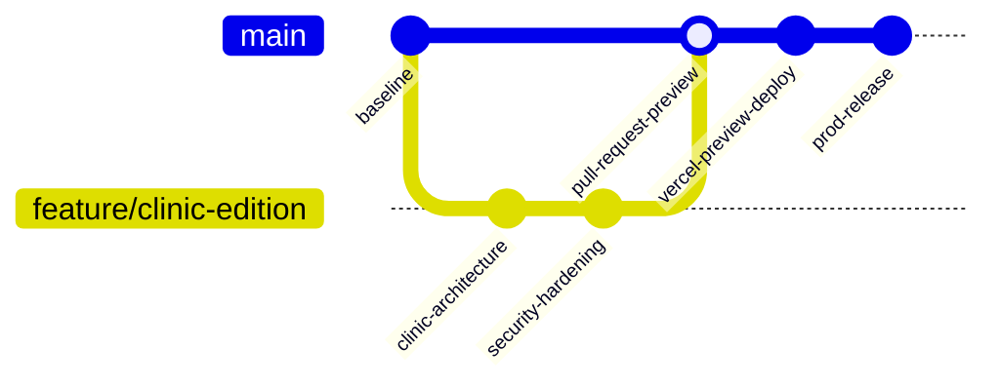

# CURASPHERE CLINIC EDITION — DEPLOYMENT & INFRASTRUCTURE PLAN
**Document ID:** `DEP-CE-007`  
**Version:** 1.0.0  
**Status:** Approved Deployment Architecture  

---

## 1. Hosting Architecture Overview

The production architecture decouples the frontend static Single Page Application (SPA) from the containerized ASP.NET Core Web API:

```
                  ┌────────────────────────────────────────┐
                  │            Vercel Edge CDN             │
                  │       (React 19 / Vite SPA)            │
                  │    https://clinic.curasphere.com       │
                  └──────────────────┬─────────────────────┘
                                     │
                    HTTPS Requests   │   Authorization: Bearer <JWT>
                    (CORS Allowed)   │
                                     ▼
                  ┌────────────────────────────────────────┐
                  │      Container Host (.NET 8 API)       │
                  │   (Render / Railway / Azure Apps)      │
                  │     https://api.curasphere.com         │
                  └──────────────────┬─────────────────────┘
                                     │
                    SSL Encrypted    │   EF Core 8 Npgsql
                    Connection Pool  │
                                     ▼
                  ┌────────────────────────────────────────┐
                  │          Managed PostgreSQL 16         │
                  │       (Neon / Supabase / AWS RDS)      │
                  │       `curasphere_production_db`       │
                  └────────────────────────────────────────┘
```

---

## 2. Frontend Vercel Deployment Configuration

### Project Settings in Vercel Dashboard
- **Root Directory:** `frontend`
- **Framework Preset:** `Vite`
- **Build Command:** `npm run build`
- **Output Directory:** `dist`
- **Install Command:** `npm ci`

### Vercel Routing Configuration ([`frontend/vercel.json`](file:///c:/Users/LENOVO/Downloads/-CuraSphere-HMS-DevelopbyUzaii-main/-CuraSphere-HMS-DevelopbyUzaii-main/frontend/vercel.json))
To ensure React Router HTML5 push-state routing works across deep links (e.g. `/appointments`, `/patients/101`), the SPA rewrite must be enforced:

```json
{
  "$schema": "https://openapi.vercel.sh/vercel.json",
  "framework": "vite",
  "buildCommand": "npm run build",
  "outputDirectory": "dist",
  "rewrites": [
    {
      "source": "/(.*)",
      "destination": "/index.html"
    }
  ],
  "headers": [
    {
      "source": "/assets/(.*)",
      "headers": [
        {
          "key": "Cache-Control",
          "value": "public, max-age=31536000, immutable"
        }
      ]
    }
  ]
}
```

### Frontend Environment Variables
| Variable Name | Environment | Sample Value | Purpose |
| :--- | :--- | :--- | :--- |
| `VITE_API_BASE_URL` | Production | `https://api.curasphere.com` | Base URL for Axios client requests |
| `VITE_API_BASE_URL` | Preview | `https://api-staging.curasphere.com` | Staging API target for PR previews |
| `VITE_APP_EDITION` | Production / Preview | `clinic` | Sets default application mode |

---

## 3. Backend ASP.NET Core 8 Hosting Plan

Vercel does not natively run long-running .NET Web API processes. The backend runs as a Linux container using the existing optimized multi-stage [`backend/CuraSphere.Api/Dockerfile`](file:///c:/Users/LENOVO/Downloads/-CuraSphere-HMS-DevelopbyUzaii-main/-CuraSphere-HMS-DevelopbyUzaii-main/backend/CuraSphere.Api/Dockerfile).

### Recommended Container Hosts
1. **Render.com / Railway.app:** Native Docker deployments, automated Git-push triggers, built-in SSL termination, zero maintenance.
2. **Azure Container Apps:** Enterprise HIPAA-compliant cloud hosting with private virtual network integration to Azure Database for PostgreSQL.

### Backend Environment Variables
| Variable Name | Environment | Value / Secret Description |
| :--- | :--- | :--- |
| `ASPNETCORE_ENVIRONMENT` | Production | `Production` |
| `ConnectionStrings__DefaultConnection` | Production | Host connection string with `SslMode=Require;Include Error Detail=false;` |
| `JwtSettings__Secret` | Production | Cryptographically secure 64-character hex secret (stored in Vault / Secrets Manager) |
| `JwtSettings__Issuer` | Production | `CuraSphereApi` |
| `JwtSettings__Audience` | Production | `CuraSphereClient` |
| `JwtSettings__ExpiryInMinutes` | Production | `60` |
| `Cors__AllowedOrigins` | Production | Semicolon-delimited production origins (e.g. `https://clinic.curasphere.com`) |

---

## 4. CORS and HTTPS Security Policy

In [`Program.cs`](file:///c:/Users/LENOVO/Downloads/-CuraSphere-HMS-DevelopbyUzaii-main/-CuraSphere-HMS-DevelopbyUzaii-main/backend/CuraSphere.Api/Program.cs), the CORS policy is configured dynamically from configuration to support both production domains and Git-triggered Vercel preview URLs:

```csharp
builder.Services.AddCors(options =>
{
    options.AddPolicy("CuraSphereCorsPolicy", policy =>
    {
        var configuredOrigins = builder.Configuration["Cors:AllowedOrigins"]?
            .Split(';', StringSplitOptions.RemoveEmptyEntries | StringSplitOptions.TrimEntries) 
            ?? new[] { "http://localhost:3000" };

        policy.WithOrigins(configuredOrigins)
              .SetIsOriginAllowedToAllowWildcardSubdomains()
              .SetIsOriginAllowed(origin => 
                  // Permits Vercel preview deployment URLs matching *.vercel.app
                  new Uri(origin).Host.EndsWith(".vercel.app") || configuredOrigins.Contains(origin))
              .AllowAnyMethod()
              .AllowAnyHeader()
              .AllowCredentials();
    });
});
```

---

## 5. Controlled Database Migration Execution

### Decoupling Migrations from Web Startup
Running runtime migrations inside `Program.cs` (`context.Database.MigrateAsync()`) during web container startup is prohibited in production because:
- Multiple concurrent API container replicas will collide trying to execute DDL migrations simultaneously.
- Startup failure locks or crashes the HTTP listener.

### Production Migration Strategy
1. **Pre-Deployment Migration Job:**
   Migrations are executed as an isolated release task before traffic shifts to the new backend revision:
   ```bash
   dotnet ef database update \
       --project CuraSphere.Infrastructure \
       --startup-project CuraSphere.Api \
       --connection "$PROD_CONNECTION_STRING"
   ```
2. **Backward-Compatible Changes:** All migrations must be non-destructive (adding columns with defaults, creating new tables) ensuring zero downtime during deployments.

---

## 6. Git-Based CI/CD Workflow



1. **Pull Request Trigger:** Opening a PR against `main` triggers GitHub Actions (`ci.yml`):
   - Backend Release build & unit test run.
   - Frontend `npm ci`, `vitest run`, `tsc --noEmit`, and `npm run build`.
   - Vercel automatically posts an ephemeral Preview URL (e.g. `https://curasphere-git-feature-clinic.vercel.app`).
2. **Merge & Production Promotion:** Merging into `main` promotes the frontend bundle to the production Vercel edge network and triggers the backend release container deployment.
