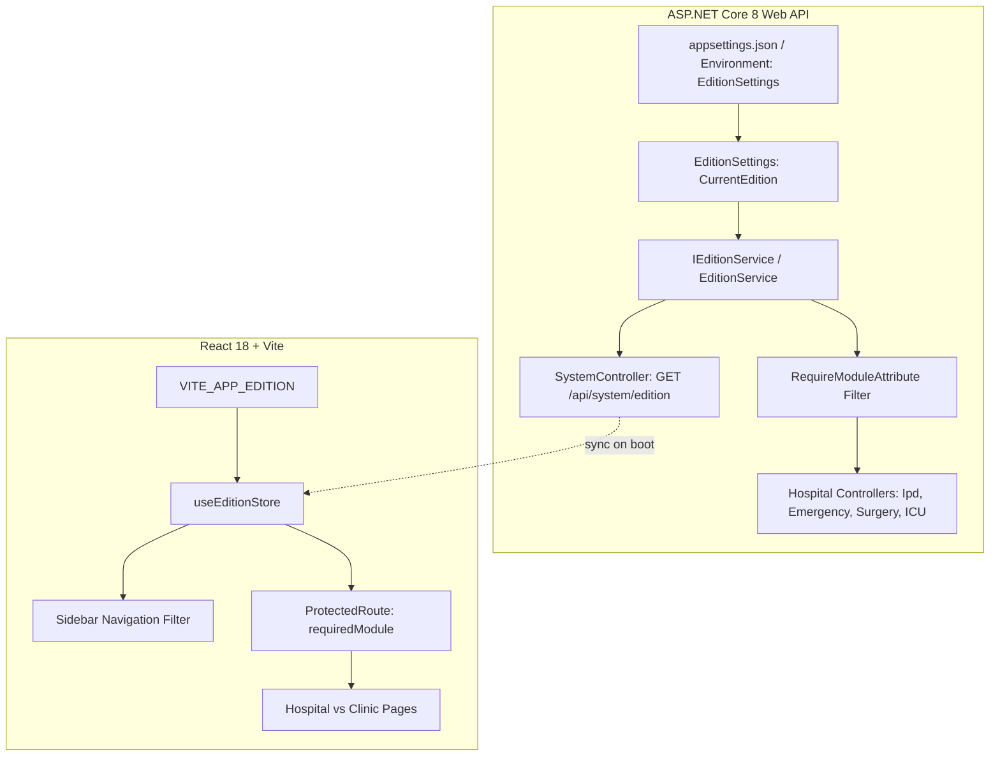

# CURASPHERE CLINIC EDITION
## SESSION 4 — EDITION CONFIGURATION & NAVIGATION FOUNDATIONS

---

### Executive Summary

Session 4 establishes the centralized, strongly typed **Edition Configuration & Navigation Architecture** for CuraSphere. The system now supports discrete deployment editions:
- **Hospital Edition (`Hospital`):** Complete enterprise healthcare management with all modules enabled (OPD, IPD Wards, Emergency Triage, Surgery Operating Theaters, ICU Telemetry, Diagnostics, and Administration).
- **Clinic Edition (`Clinic`):** Streamlined for ambulatory practices and outpatient clinics, disabling high-overhead inpatient, surgical, and emergency modules while focusing on patient registration, doctor appointments, walk-in token queues, consultation EMR, and rapid counter billing.
- **Enterprise Edition (`Enterprise`):** Architecture placeholder reserved for future multi-facility hospital networks (not implemented in this session).

This foundation guarantees that:
1. Existing Hospital Edition workflows, routes, and navigation remain 100% functional and intact.
2. In Clinic Edition, hospital-only modules (`ipd`, `emergency`, `surgery`, `icu`) are stripped from sidebar navigation and blocked at both frontend route guards and backend API controllers.
3. Edition enablement is strictly decoupled from user authorization: a module being enabled does not bypass role-based access control.
4. Missing, unknown, or corrupted edition configurations fail safe to the backward-compatible default: **`Hospital Edition`**.

---

### 1. Edition Configuration Architecture

The edition configuration system follows a dual-tier, authoritative design across the stack:



#### Backend Layer
- **`EditionType` Enum:** [`backend/CuraSphere.Application/Common/EditionType.cs`](file:///backend/CuraSphere.Application/Common/EditionType.cs) (`Hospital = 1`, `Clinic = 2`, `Enterprise = 3`).
- **`ModuleId` Enum:** [`backend/CuraSphere.Application/Common/ModuleId.cs`](file:///backend/CuraSphere.Application/Common/ModuleId.cs) assigning distinct enum keys to all capabilities.
- **`EditionSettings`:** [`backend/CuraSphere.Application/Common/EditionSettings.cs`](file:///backend/CuraSphere.Application/Common/EditionSettings.cs) binds `EditionSettings:CurrentEdition` with fail-safe fallback to `Hospital`.
- **`IEditionService` & `EditionService`:** Authoritative registry pre-computing enabled and disabled modules per deployment edition.
- **`RequireModuleAttribute`:** Action filter returning `HTTP 403 Forbidden` (`EDITION_MODULE_DISABLED`) if a client invokes endpoints belonging to an edition-disabled module.
- **`SystemController`:** Exposes `GET /api/system/edition` returning edition name, enabled modules, and disabled modules.

#### Frontend Layer
- **`EditionType` & `ModuleId` Types:** [`frontend/src/types/edition.ts`](file:///frontend/src/types/edition.ts).
- **`editionConfig.ts`:** [`frontend/src/config/editionConfig.ts`](file:///frontend/src/config/editionConfig.ts) containing `HOSPITAL_EDITION_CONFIG`, `CLINIC_EDITION_CONFIG`, and safe resolution helpers.
- **`useEditionStore`:** [`frontend/src/stores/editionStore.ts`](file:///frontend/src/stores/editionStore.ts) managing active edition state, synchronizing with `GET /api/system/edition`, and exposing `isModuleEnabled(moduleId)`.
- **`Sidebar.tsx`:** Dynamically filters navigation links by active edition and user permissions; suppresses empty section headers.
- **`ProtectedRoute.tsx`:** Validates `requiredModule` alongside `requiredPermission`, rendering an informative "Edition Restriction" screen when a disabled module is accessed directly via URL.

---

### 2. Capability Matrix: Shared vs. Edition-Specific

| Module ID | Capability Label | Category | Hospital Edition | Clinic Edition | Backend Controller / Route |
| :--- | :--- | :--- | :---: | :---: | :--- |
| `dashboard` | Operational Dashboard | Shared | ✅ Enabled | ✅ Enabled | `/dashboard` |
| `patients` | Patient Registration & MRN | Shared | ✅ Enabled | ✅ Enabled | `PatientController` (`/patients`) |
| `doctors` | Doctors Directory | Shared | ✅ Enabled | ✅ Enabled | `/doctors` |
| `nurses` | Nurses Desk | Shared | ✅ Enabled | ✅ Enabled | `/nurses` |
| `appointments` | Consultation Appointments | Shared | ✅ Enabled | ✅ Enabled | `AppointmentController` (`/appointments`) |
| `opd` | Outpatient Queue & Tokens | Shared | ✅ Enabled | ✅ Enabled | `OpdController` (`/opd`) |
| `emr` | EMR Clinical Consultation | Shared | ✅ Enabled | ✅ Enabled | `/emr` |
| `laboratory` | Laboratory Diagnostics | Shared | ✅ Enabled | ✅ Enabled | `DiagnosticsController` (`/laboratory`) |
| `radiology` | Radiology / PACS | Shared | ✅ Enabled | ✅ Enabled | `DiagnosticsController` (`/radiology`) |
| `pharmacy` | Pharmacy Dispensary | Shared | ✅ Enabled | ✅ Enabled | `ClinicalServicesController` (`/pharmacy`) |
| `billing` | Invoices & Billing | Shared | ✅ Enabled | ✅ Enabled | `FinancialController` (`/billing`) |
| `payments` | Payments Cashier | Shared | ✅ Enabled | ✅ Enabled | `FinancialController` (`/payments`) |
| `insurance` | Insurance Claims | Shared | ✅ Enabled | ✅ Enabled | `FinancialController` (`/insurance`) |
| `inventory` | Store & Pharmacy Stock | Shared | ✅ Enabled | ✅ Enabled | `OperationsController` (`/inventory`) |
| `hr` | HR Employees | Shared | ✅ Enabled | ✅ Enabled | `OperationsController` (`/hr`) |
| `attendance` | Duty Roster & Attendance | Shared | ✅ Enabled | ✅ Enabled | `OperationsController` (`/attendance`) |
| `reports` | BI & Financial Reports | Shared | ✅ Enabled | ✅ Enabled | `ReportsController` (`/reports`) |
| `notifications` | System Notifications | Shared | ✅ Enabled | ✅ Enabled | `/notifications` |
| `audit` | Audit & Compliance Logs | Shared | ✅ Enabled | ✅ Enabled | `/audit` |
| `administration`| System Configuration | Shared | ✅ Enabled | ✅ Enabled | `LookupController` (`/administration`) |
| **`ipd`** | **Inpatient Wards & Beds** | **Hospital-Only** | **✅ Enabled** | **❌ Disabled** | `IpdController` (`/ipd`) |
| **`emergency`** | **Emergency Triage (ER)** | **Hospital-Only** | **✅ Enabled** | **❌ Disabled** | `EmergencyController` (`/emergency`) |
| **`surgery`** | **Surgery Operating Theaters** | **Hospital-Only** | **✅ Enabled** | **❌ Disabled** | `ClinicalServices/surgery` (`/surgery`) |
| **`icu`** | **ICU Telemetry Monitoring** | **Hospital-Only** | **✅ Enabled** | **❌ Disabled** | `ClinicalServices/icu` (`/icu`) |
| `clinic-workspace`| Single-Screen Clinic Desk | Clinic Focus | ⏳ Session 5 | ⏳ Session 5 | `/clinic` (Planned) |
| `clinic-queue` | Walk-in Token Dispenser | Clinic Focus | ⏳ Session 5 | ⏳ Session 5 | `/clinic/queue` (Planned) |
| `clinic-billing` | Rapid Counter Billing Slip | Clinic Focus | ⏳ Session 5 | ⏳ Session 5 | `/clinic/billing` (Planned) |

---

### 3. How to Register a New Module

Adding a new capability to the application requires 3 straightforward steps:

#### Step 1: Declare the Module Identifier
1. Add the enum key to [`backend/CuraSphere.Application/Common/ModuleId.cs`](file:///backend/CuraSphere.Application/Common/ModuleId.cs):
   ```csharp
   public enum ModuleId { ..., MyNewFeature = 301 }
   ```
2. Add the union type string to [`frontend/src/types/edition.ts`](file:///frontend/src/types/edition.ts):
   ```ts
   export type ModuleId = ... | "my-new-feature";
   ```

#### Step 2: Register Capability in Edition Configs
In [`frontend/src/config/editionConfig.ts`](file:///frontend/src/config/editionConfig.ts):
- Add the module definition to `ALL_MODULE_DEFINITIONS` with category (`shared`, `hospital`, or `clinic`).
- Include it in `HOSPITAL_EDITION_CONFIG.enabledModules` or `CLINIC_EDITION_CONFIG.enabledModules`.

In [`backend/CuraSphere.Infrastructure/Services/EditionService.cs`](file:///backend/CuraSphere.Infrastructure/Services/EditionService.cs):
- Add `ModuleId.MyNewFeature` to `SharedModules`, `HospitalOnlyModules`, or `ClinicSpecializedModules`.

#### Step 3: Protect Route & Backend Endpoint
1. In `App.tsx`: wrap the page in `<ProtectedLayout module="my-new-feature" permission="feature.read">`.
2. In the API Controller: decorate with `[RequireModule(ModuleId.MyNewFeature)]`.

---

### 4. How Navigation Filtering Works

In [`frontend/src/components/layout/Sidebar.tsx`](file:///frontend/src/components/layout/Sidebar.tsx), each navigation item contains a `moduleId: ModuleId`:

```ts
const isAllowed = (item: NavItem) => {
  // 1. Centralized Edition check: module must be enabled in active edition
  if (item.moduleId && !isModuleEnabled(item.moduleId)) {
    return false;
  }

  // 2. Role check (Super Administrator / Hospital Administrator sees all enabled modules)
  if (userRole === "Super Administrator" || userRole === "Hospital Administrator") {
    return true;
  }

  // 3. Explicit role check
  if (item.roles && item.roles.includes(userRole)) {
    return true;
  }

  // 4. Permission claim check
  if (item.permission && permissions.includes(item.permission)) {
    return true;
  }

  return !item.permission && !item.roles;
};
```

This ensures that:
- In **Clinic Edition**, `IPD Wards`, `Emergency Triage`, `Surgery OT`, and `ICU Telemetry` items never render.
- If an entire section has 0 enabled items (e.g., if a user lacks permissions for all items in that category), the section header is cleanly omitted.

---

### 5. Backend Authorization vs. Edition Governance

> [!IMPORTANT]
> Edition configuration is a **deployment capability constraint**, NOT an authorization bypass.
> - An enabled module **still requires** valid JWT authentication and role/permission authorization.
> - Disabling a module on the frontend does not secure the API: the backend [`RequireModuleAttribute`](file:///backend/CuraSphere.Api/Filters/RequireModuleAttribute.cs) intercepts HTTP requests and terminates with `HTTP 403 Forbidden` if a client calls disabled endpoints.

---

### 6. Environment Configuration

#### Backend Configuration
Configure in `appsettings.json` or via environment variable `EditionSettings__CurrentEdition`:
```json
{
  "EditionSettings": {
    "CurrentEdition": "Hospital",
    "FacilityName": "CuraSphere Medical Center"
  }
}
```

Environment Variable:
```bash
EditionSettings__CurrentEdition=Clinic
```

#### Frontend Configuration
Configure in `frontend/.env` or `.env.production`:
```bash
VITE_APP_EDITION=Hospital
```

#### Docker Compose
```yaml
environment:
  - EditionSettings__CurrentEdition=${CURASPHERE_EDITION:-Hospital}
```

---

### 7. Verification & Test Results

#### Automated Backend Unit Tests (`backend/tests/CuraSphere.UnitTests`)
- **Total Tests:** 18 Tests.
- **Results:** 18 Passed, 0 Failed.
- **New Tests Added (Session 4):**
  - `[PASS]` `EditionSettings` correctly parses `"Hospital"` and `"Clinic"`.
  - `[PASS]` `EditionSettings` safely defaults to `Hospital` on unknown or null edition string.
  - `[PASS]` `EditionService` in Hospital Edition enables all capabilities (0 disabled modules).
  - `[PASS]` `EditionService` in Clinic Edition disables `Ipd`, `Emergency`, `Surgery`, and `Icu`, while keeping shared modules enabled.
  - `[PASS]` `RequireModule` gate blocks disabled modules in Clinic Edition with `EDITION_MODULE_DISABLED`.

#### Automated Frontend Tests (`frontend/src/__tests__`)
- **Total Test Files:** 5 passed (20 tests total).
- **Results:** 20 Passed, 0 Failed.
  - `src/__tests__/edition-navigation.test.ts` (6 tests passed):
    - Hospital Edition enables all modules.
    - Clinic Edition disables hospital-only modules.
    - `getEditionConfig` safely falls back to Hospital Edition on unknown or null inputs.
    - `isModuleEnabledForEdition` helper accurately evaluates capabilities.
    - Sidebar navigation excludes disabled hospital modules in Clinic Edition.
    - Module enablement does not bypass user role/permission checks.
  - `src/__tests__/auth-security.test.ts` (6 tests passed).
  - `src/__tests__/documents.test.ts` (2 tests passed).
  - `src/__tests__/triage.test.ts` (3 tests passed).
  - `src/__tests__/patient.test.ts` (3 tests passed).

#### Build & Code Quality
- **ESLint:** `npm run lint` — 0 errors.
- **TypeScript:** `npx tsc -b` — 0 errors.
- **Production Bundle:** `npm run build` — Built successfully (`dist/assets/index-*.js`, `dist/assets/index-*.css`).
- **Live Local Server:** Background dev server listening on `http://localhost:3000/`.

---

### 8. Known Limitations & Next Steps

1. **Current Session Scope:**
   - As mandated by Session 4 boundaries, the full single-screen Clinic consultation desk UI (`/clinic`) was not built in this session. The foundation, navigation registry, routing guards, and backend enforcement are established and tested.
2. **Next Recommended Step (Session 5):**
   - Implement the **Clinic Edition Single-Provider & Multi-Specialty Consultation Workspace** (`/clinic`), quick token generator (`/clinic/queue`), and counter billing receipt slip (`/clinic/billing`).
