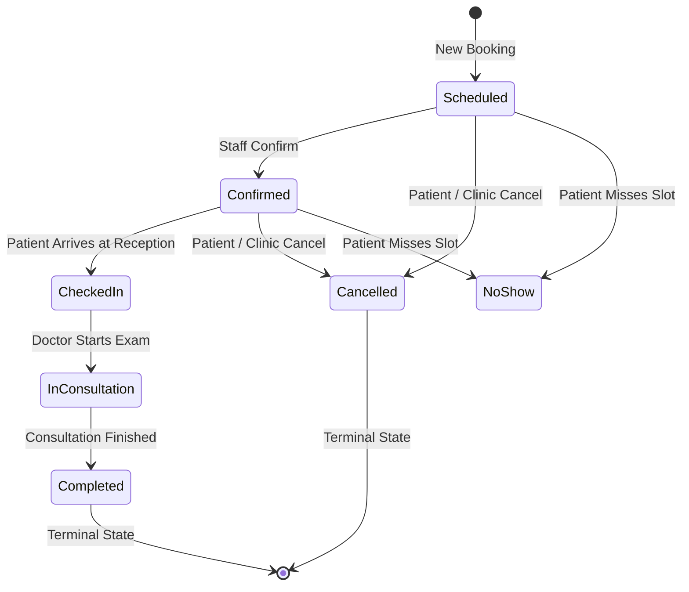

# CURASPHERE CLINIC EDITION — SESSION 6: PATIENT REGISTRATION & APPOINTMENT MANAGEMENT
**Document ID:** `DOC-CE-012`  
**Version:** 1.0.0  
**Status:** Completed & Verified  
**Date:** October 2026  

---

## 1. Overview & Architectural Alignment

Session 6 extends CuraSphere with robust, connected patient registration and appointment management workflows tailored for the **Clinic Edition** while fully preserving Hospital Edition capabilities.

Rather than duplicating domain entities or building parallel data models, this session:
- Reused and extended existing Clean Architecture entities (`Patient`, `Appointment`, `Doctor`, `Department`, `Employee`).
- Added robust server-side double-booking conflict detection, status transition enforcement, and rescheduling logic.
- Resolved ASP.NET Core model binding and navigation flow issues.
- Connected the frontend `PatientRegistration`, `PatientList`, `PatientProfile`, and `AppointmentsPage` into an intuitive outpatient reception experience with one-click direct appointment triggers, real-time patient autocomplete search, doctor fee displays, time slot selectors, and printable consultation slip passes.

---

## 2. Implemented Patient Management Workflows

### 2.1 Patient Directory & Real-Time Search
- **List & Paged Results:** Staff view patient records retrieved via `GET /api/patient` with total counts, medical record numbers (MRNs), age, gender, contact number, and status.
- **Search Capabilities:** Search by Patient Name (First/Last), MRN identifier, or Contact phone number.
- **Direct Appointment Action:** Each row in `PatientList.tsx` provides a direct `<Calendar />` action button navigating to `/appointments?patientId={id}&patientName={name}&mrn={mrn}`, pre-populating the booking modal.
- **Patient Detail & Demographics Edit:** View comprehensive demographic data in `PatientProfile.tsx`, with permitted editing of contact phone, address, and emergency contact details under `patients.update` authorization.

### 2.2 Patient Registration & Duplicate Prevention
- **Demographic Intake:** Capture mandatory fields (`firstName`, `lastName`, `gender`, `dateOfBirth`, `phoneNumber`, `address`, `city`, `province`, `emergencyContactName`, `emergencyContactPhone`, `emergencyRelationship`, `patientStatus`) alongside optional identifiers (`cnicPassport`, `email`, `bloodGroupId`, `maritalStatusId`).
- **Duplicate Detection Engine:**
  - Automated pre-flight check against `POST /api/patient/check-duplicate` evaluating exact matches across `(firstName, lastName, dateOfBirth)` or government ID `cnicPassport`.
  - Non-blocking duplicate review modal allows reception staff to inspect existing matching patient records before deciding whether to proceed with a new registration or open an existing profile.
- **Immediate Next-Action Workflow:** Following successful creation, staff are presented with immediate next steps: view the newly registered patient profile or book an initial consultation.

---

## 3. Implemented Appointment Management Workflows

### 3.1 Outpatient Appointment Scheduling
- **Patient Lookup & Autocomplete:** Search existing registered patients by name or MRN directly within the booking dialog. Also accepts URL query parameters to pre-fill patient data.
- **Provider & Department Selection:** Dynamic lookup populated from `GET /api/appointment/doctors` and `GET /api/appointment/departments`. Displays doctor specialty and consultation fee (e.g., `Dr. Sarah Jenkins - Cardiology (Fee: $50)`).
- **Time Slot Selection:** Generates 15-minute standard outpatient booking slots from 09:00 AM to 05:00 PM. Restricts date selection to today or future dates (`min={today}`).
- **Double-Booking Conflict Prevention:** The backend checks:
  ```csharp
  bool hasConflict = await _context.Appointments
      .AnyAsync(a => a.DoctorId == request.DoctorId
                  && a.AppointmentDate.Date == request.AppointmentDate.Date
                  && a.AppointmentTime == timeSpan
                  && a.Status != "Cancelled");
  ```
  If a conflict occurs, the API returns `409 Conflict`, and the UI displays an alert banner preventing duplicate slot allocation.

### 3.2 Clinical Status Lifecycle Machine
Appointments progress through defined outpatient stages:

- **Valid Transitions Enforced:**
  - `Scheduled` $\rightarrow$ `Confirmed`, `Cancelled`, `No Show`
  - `Confirmed` $\rightarrow$ `Checked In`, `Cancelled`, `No Show`
  - `Checked In` $\rightarrow$ `In Consultation`, `Cancelled`
  - `In Consultation` $\rightarrow$ `Completed`
  - Terminal states (`Completed`, `Cancelled`) cannot be overwritten or transitioned further.
- **Rescheduling:** Allowed only from active non-terminal states (`Scheduled`, `Confirmed`). The reschedule engine updates `AppointmentDate`, `AppointmentTime`, and optionally `DoctorId`, re-verifying that the new target slot has no existing bookings.

### 3.3 Printable Consultation Slip Pass
- Staff can generate and print an outpatient slip pass with clinic branding, patient details, MRN barcode representation, appointment date/time, doctor name, and consultation room.

---

## 4. API Endpoints & Contracts

### 4.1 Patient Endpoints
| HTTP Method | Route | Description | Authorization |
| :--- | :--- | :--- | :--- |
| `GET` | `/api/patient` | Get paginated patient list with search filter | `patients.view` |
| `GET` | `/api/patient/{id}` | Get complete patient details | `patients.view` |
| `POST` | `/api/patient` | Register new patient record | `patients.create` |
| `PUT` | `/api/patient/{id}` | Update patient demographics | `patients.update` |
| `POST` | `/api/patient/check-duplicate` | Check for existing duplicate records | `patients.create` |
| `GET` | `/api/patient/search` | Quick patient search by query string | `patients.view` |

### 4.2 Appointment Endpoints
| HTTP Method | Route | Description | Authorization |
| :--- | :--- | :--- | :--- |
| `GET` | `/api/appointment` | List all appointments with doctor/department details | `appointments.view` |
| `GET` | `/api/appointment/{id}` | Get appointment details by ID | `appointments.view` |
| `POST` | `/api/appointment` | Create appointment with conflict validation | `appointments.create` |
| `PATCH` | `/api/appointment/{id}/status` | Update status (accepts `UpdateAppointmentStatusDto`) | `appointments.update` |
| `PATCH` | `/api/appointment/{id}/reschedule` | Reschedule date/time/doctor with slot validation | `appointments.update` |
| `GET` | `/api/appointment/doctors` | Lookup active clinic doctors with fees and department | `appointments.view` |
| `GET` | `/api/appointment/departments` | Lookup clinic departments | `appointments.view` |

---

## 5. DTOs & Domain Models

### 5.1 New & Extended DTOs (`AppointmentDto.cs`)
```csharp
public class UpdateAppointmentStatusDto
{
    [Required]
    public string Status { get; set; } = string.Empty;
    public string? Remarks { get; set; }
}

public class RescheduleAppointmentDto
{
    [Required]
    public DateTime AppointmentDate { get; set; }
    [Required]
    public string AppointmentTime { get; set; } = string.Empty;
    public int? DoctorId { get; set; }
    public string? Remarks { get; set; }
}

public class DoctorLookupDto
{
    public int DoctorId { get; set; }
    public string FullName { get; set; } = string.Empty;
    public string Specialization { get; set; } = string.Empty;
    public string DepartmentName { get; set; } = string.Empty;
    public decimal ConsultationFee { get; set; }
}

public class DepartmentLookupDto
{
    public int DepartmentId { get; set; }
    public string DepartmentName { get; set; } = string.Empty;
}
```

---

## 6. Security, Authorization & Privacy

1. **Role-Based Permissions:**
   - Patient creation and demographic editing require `patients.create` and `patients.update`.
   - Appointment booking and rescheduling require `appointments.create` and `appointments.update`.
   - Unprivileged roles (e.g., Guest, Billing-only) are prevented from modifying clinical queues or patient records.
2. **Privacy Protections:**
   - Patient contact phone numbers and government IDs are shielded from public URLs.
   - List views limit exposed fields to necessary identifiers, avoiding leaking full medical histories or emergency contacts.
   - Sensitive clinical data is excluded from unauthenticated endpoints.

---

## 7. Verification & Test Execution

### 7.1 Automated Test Suites (Vitest)
A dedicated test suite [`frontend/src/__tests__/patient-appointment-workflows.test.ts`](file:///frontend/src/__tests__/patient-appointment-workflows.test.ts) was created, covering 7 distinct test scenarios alongside 6 existing test suites:
- **Demographic Validation:** Verifies required fields and string length boundaries.
- **Duplicate Check Engine:** Tests exact match and CNIC match scenarios.
- **Role Permissions:** Confirms strict permission enforcement (`patients.create`, `patients.update`).
- **Missing Reference Rejection:** Validates required patient, doctor, and date/time fields.
- **Double-Booking Conflict Prevention:** Verifies slot overlap rejection.
- **Status Lifecycle Transitions:** Verifies sequential transitions and blocks invalid ones.
- **Rescheduling Workflow:** Verifies date/time update rules and terminal state guards.

**Test Run Output:**
```
 RUN  v4.1.11 frontend
 ✓ src/__tests__/triage.test.ts (3 tests)
 ✓ src/__tests__/documents.test.ts (2 tests)
 ✓ src/__tests__/auth-security.test.ts (6 tests)
 ✓ src/__tests__/patient-appointment-workflows.test.ts (7 tests)
 ✓ src/__tests__/patient.test.ts (3 tests)
 ✓ src/__tests__/edition-navigation.test.ts (6 tests)
 ✓ src/__tests__/clinic-dashboard.test.ts (5 tests)

 Test Files  7 passed (7)
      Tests  32 passed (32)
```

### 7.2 Frontend Compilation & Linting
- **TypeScript (`tsc -b`):** 0 errors.
- **Vite Production Bundle (`vite build`):** Built successfully in 1.17s.
- **ESLint (`npm run lint`):** 0 errors, 0 warnings.

---

## 8. Remaining Limitations & Next Steps

1. **Session 7 Scope (EMR & Doctor Workspace):**
   - The status transition to `In Consultation` links to `/emr?appointmentId=...`. Session 7 will implement the doctor consultation workspace, subjective/objective clinical examination notes, ICD-10 diagnosis selector, and prescription (Rx) builder.
2. **Session 8 Scope (Consultation Billing):**
   - Direct payment generation from completed appointments into the POS cashier will be implemented in Session 8.
