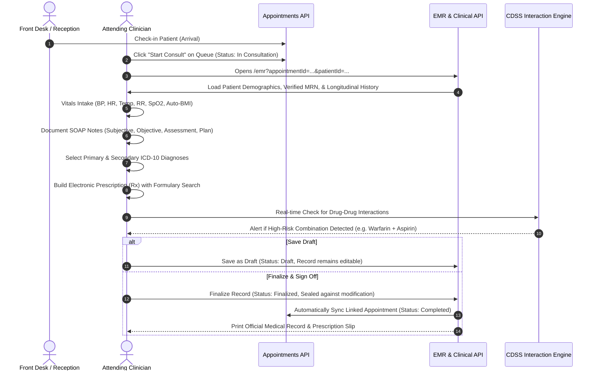

# CURASPHERE CLINIC EDITION — SESSION 7: DOCTOR CONSULTATION & CLINICAL RECORDS
**Document ID:** `DOC-CE-013`  
**Version:** 1.0.0  
**Status:** Completed & Verified  
**Date:** October 2026  

---

## 1. Overview & Clinical Workflow Design

Session 7 establishes the dedicated **Doctor Consultation Workspace** and outpatient **Electronic Medical Records (EMR)** module for the CuraSphere Clinic Edition, directly bridging the reception queue and appointment lifecycle into clinical care.

### 1.1 Complete Outpatient Clinical Journey


---

## 2. Implemented Capabilities & Components

### 2.1 Clinician Consultation Workspace (`EMRPage.tsx`)
- **Patient Identity Verification:** Top banner verifying patient full name, unique MRN, age, gender, contact number, emergency contact, and blood group. Displays a verified identity badge matching the clinical record.
- **Appointment Context:** Identifies appointment date, time, reason for visit, attending doctor, and department.
- **Longitudinal History Review:** Displays previous clinical encounters for the patient (`GET /api/emr/encounters/patient/{id}`) with past diagnoses, clinical notes, and medication regimens. Gracefully handles baseline visits when no prior history is on file.
- **Allergy Notice & Safety Protocol:** Reminds clinicians that absence of allergy records in outpatient intake necessitates verbal allergy confirmation before prescribing.
- **Vital Signs Intake Card:** Dedicated inputs for Blood Pressure (Systolic/Diastolic), Heart Rate, Temperature, Respiratory Rate, Oxygen Saturation (SpO2), Weight, and Height, featuring automated BMI computation and clinical category classification (Normal, Overweight, Obese).
- **SOAP Clinical Documentation:**
  - **Subjective (S):** Chief complaint with quick symptom tags and History of Present Illness (HPI).
  - **Objective (O):** Physical examination findings and vital observations.
  - **Assessment (A):** Clinical impression and differential rationale.
  - **Plan (P):** Treatment plan, investigative tests, and lifestyle counselling.
- **ICD-10 Diagnostic Engine:**
  - Common outpatient ICD-10 diagnostic library (`I10`, `E11.9`, `J06.9`, `K21.9`, `M54.5`, `R51.9`, `J45.909`, `A09`, `N39.0`, etc.) plus custom input.
  - Support for multiple diagnoses with explicit Primary vs Secondary designation.
- **Electronic Prescription (Rx) Builder:**
  - Auto-suggest search from clinic pharmacy formulary (`GET /api/clinicalservices/pharmacy/stock`).
  - Standardized dosage, route (Oral, Topical, Inhalation, IV, IM, Sublingual), frequency (OD, BID, TID, QID, PRN, STAT), duration, quantity, and specific patient instructions.
  - **Clinical Decision Support (CDSS):** Real-time drug-drug interaction checker alerting providers to dangerous interactions (e.g., Warfarin + Aspirin, Lisinopril + Spironolactone).
- **Follow-up & Disposition:**
  - Return interval picker (3 days, 1 week, 2 weeks, 1 month, PRN) and specific discharge instructions.
- **Printable Consultation Summary & Prescription Slip:**
  - Modal rendering clean clinical prescription layout with clinic branding, patient MRN barcode representation, vital signs, primary diagnosis with ICD-10 code, doctor clinical notes, Rx medication table, and authorized clinician signature line.

### 2.2 EMR Registry & Encounter Directory
- Lists all outpatient encounters with search filtering by patient name, MRN, diagnosis, and encounter number.
- Status filters for `All`, `Finalized`, and `Draft`.
- Fast view/print modal for any historical clinical encounter.

---

## 3. Backend Architecture & Clean Architecture Separation

### 3.1 DTOs (`backend/CuraSphere.Application/DTOs/EmrDto.cs`)
- `VitalSignsDto`: Strongly typed BP, heart rate, temp, resp rate, SpO2, weight, height, BMI.
- `DiagnosisItemDto`: ICD-10 code, clinical description, primary indicator, notes.
- `PrescriptionItemDto`: Medication name, generic name, dosage, route, frequency, duration, quantity, instructions.
- `CreateEmrEncounterDto`: Request payload supporting draft vs finalization flags.
- `EmrEncounterDto`: Comprehensive response payload including populated patient and attending doctor details.
- `DrugInteractionCheckRequest` & `DrugInteractionCheckResponse`: CDSS payload.

### 3.2 Service Layer (`backend/CuraSphere.Application/Interfaces/IEmrService.cs` & `EmrService.cs`)
- Reuses existing Clean Architecture domain entity `EmrEncounter` in `CuraSphere.Domain.Entities.Clinical`.
- High-fidelity structured clinical payload (SOAP, Vitals, itemized Diagnoses, Prescriptions, Follow-up) is serialized cleanly into `ClinicalNotes` JSON, while preserving native database columns `Diagnosis` (Primary ICD-10 summary) and `Symptoms` (Chief complaint).
- **Zero Schema Migrations / Breaking Changes:** Backward-compatible with all existing database queries and tables.
- **Finalized Record Immutability:** Enforces security check:
  ```csharp
  if (encounter.Status == "Finalized" || encounter.Status == "SignedOff")
  {
      throw new InvalidOperationException("Cannot modify or alter a finalized clinical record. Finalized records are sealed.");
  }
  ```
- **Consequential Appointment Completion:** Automatically syncs linked `Appointment` status from `In Consultation` or `Checked In` to `Completed` with audit remarks when the encounter is finalized.
- **Audit Logging:** Every draft creation, update, and finalization generates an `AuditLog` entry in the `audit` schema.

### 3.3 API Controller (`backend/CuraSphere.Api/Controllers/EmrController.cs`)
| HTTP Method | Route | Description | Required Permission |
| :--- | :--- | :--- | :--- |
| `GET` | `/api/emr/encounters` | List all encounters with search filter | `emr.read` |
| `GET` | `/api/emr/encounters/{id}` | Get encounter by ID | `emr.read` |
| `GET` | `/api/emr/encounters/patient/{patientId}` | Get longitudinal history for a patient | `emr.read` |
| `POST` | `/api/emr/encounters` | Create new encounter (draft or finalized) | `emr.create` |
| `PUT` | `/api/emr/encounters/{id}` | Update existing draft encounter | `emr.create` |
| `POST` | `/api/emr/encounters/{id}/finalize` | Finalize & sign off clinical record | `emr.diagnose` |
| `POST` | `/api/emr/check-interactions` | CDSS drug-drug interaction check | `emr.read` |

---

## 4. Security, Authorization & Patient Privacy

1. **Role-Based Access Control:**
   - Clinicians (`Doctor`) hold `emr.read`, `emr.create`, `emr.diagnose`, and `emr.prescribe`.
   - Nurses hold `emr.read` and `emr.create` (for vitals intake), but are restricted from finalizing diagnoses or prescriptions.
   - Non-clinical roles (`Cashier / Billing`, `Receptionist`) are strictly barred from `/api/emr` endpoints, preventing access to sensitive clinical notes or diagnoses.
2. **Patient Privacy & Audit Integrity:**
   - URLs and client logs do not expose sensitive clinical data or diagnostic text.
   - All mutations log action types (`EMR_DRAFT_CREATED`, `EMR_DRAFT_UPDATED`, `EMR_FINALIZED`), user IDs, affected records, and UTC timestamps.

---

## 5. Verification & Test Execution

### 5.1 Automated Vitest Test Suites
A dedicated test suite [`frontend/src/__tests__/doctor-consultation-emr.test.ts`](file:///frontend/src/__tests__/doctor-consultation-emr.test.ts) was created covering 7 distinct test scenarios alongside 7 existing test suites:
- **Mandatory Reference Validation:** Verifies rejection of missing patient, doctor, or chief complaint.
- **Vitals & BMI Classification:** Tests metric calculations and weight category classifications.
- **Draft vs Finalized Lifecycle:** Verifies editable draft workflows.
- **Finalized Record Immutability:** Verifies that finalized encounters reject modification attempts.
- **Appointment Status Synchronization:** Verifies automatic transition of linked appointments to `Completed`.
- **ICD-10 Diagnoses Formatting:** Tests primary and secondary diagnosis mapping.
- **CDSS Drug-Drug Interaction Alerts:** Verifies interaction detection for high-risk combinations (Warfarin + Aspirin, Lisinopril + Spironolactone).
- **Role Permissions Enforcement:** Verifies doctor, nurse, and cashier permission checks.

**Test Results:**
```
 RUN  v4.1.11 frontend
 ✓ src/__tests__/documents.test.ts (2 tests)
 ✓ src/__tests__/auth-security.test.ts (6 tests)
 ✓ src/__tests__/patient-appointment-workflows.test.ts (7 tests)
 ✓ src/__tests__/doctor-consultation-emr.test.ts (7 tests)
 ✓ src/__tests__/triage.test.ts (3 tests)
 ✓ src/__tests__/patient.test.ts (3 tests)
 ✓ src/__tests__/edition-navigation.test.ts (6 tests)
 ✓ src/__tests__/clinic-dashboard.test.ts (5 tests)

 Test Files  8 passed (8)
      Tests  39 passed (39)
   Duration  1.16s
```

### 5.2 Frontend Compilation & Linting
- **TypeScript (`tsc -b`):** 0 errors.
- **Vite Production Bundle (`vite build`):** Built successfully in 1.06s (`dist/assets/index-D8AGa15x.js`).
- **ESLint (`npm run lint`):** 0 errors, 0 warnings.

---

## 6. Known Limitations & Next Steps

1. **Session 8 Scope (Consultation Billing):**
   - Finalized consultations with prescribed medications and doctor fees need direct one-click invoice generation for cashier payment collection. This will be implemented in Session 8.
2. **Diagnostic Lab & Radiology Ordering:**
   - Direct electronic test requisition from the consultation plan to lab/radiology will be connected in future diagnostic extensions.
