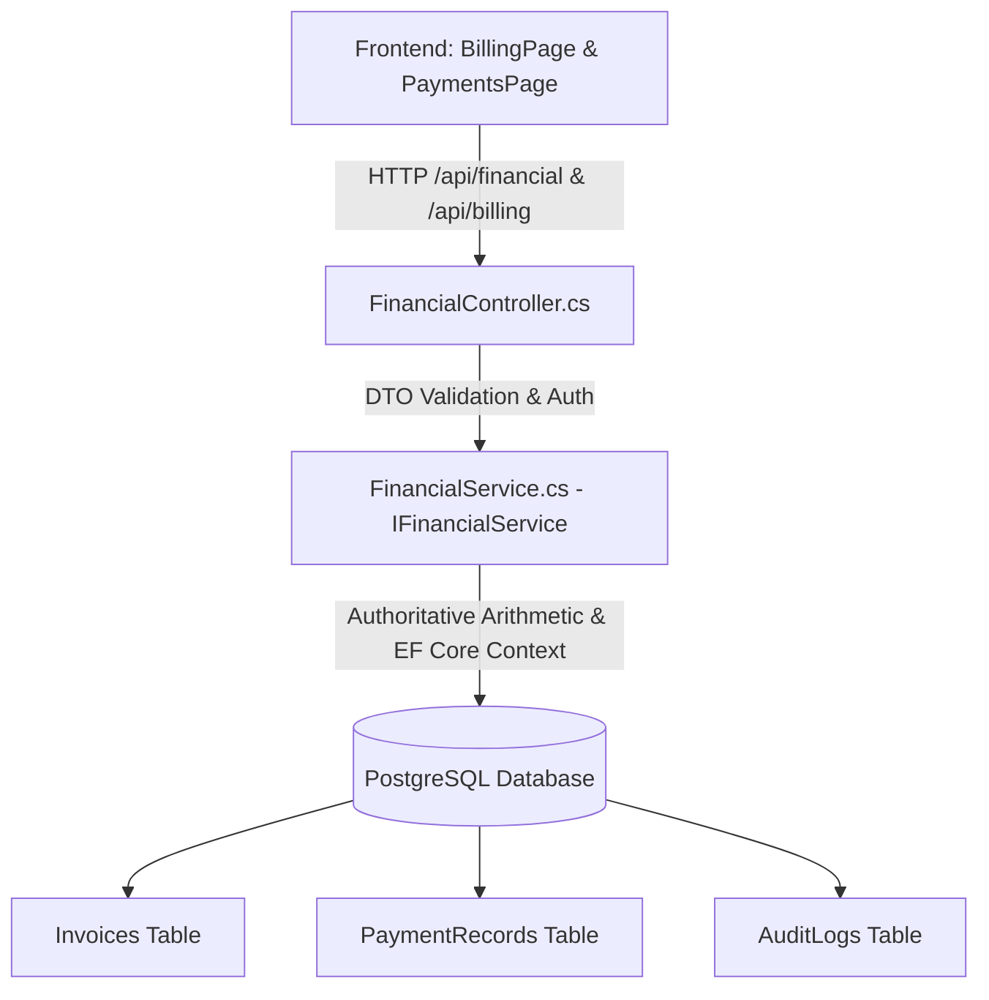

# CURASPHERE CLINIC EDITION — CLINIC BILLING, INVOICES & PAYMENTS
**Document ID:** `DOC-CE-014`  
**Version:** 1.0.0  
**Status:** Approved Technical Architecture & Implementation Report  
**Session:** Session 8: Clinic Billing, Invoices & Payments  
**Author:** CuraSphere Engineering Team  

---

## 1. Executive Summary

Session 8 delivers a comprehensive, auditable, and secure Outpatient Clinic Billing and Payment Processing subsystem for the CuraSphere Clinic Edition. The implementation extends the existing hospital financial domain model (`Invoice`, `PaymentRecord`) without creating parallel tables, duplicating ledgers, or breaking existing Hospital Edition financial workflows.

All calculations—subtotals, discounts, sales taxes, paid allocations, and balance amounts—are executed authoritatively on the ASP.NET Core backend using decimal precision arithmetic. The React/TypeScript frontend provides clinic staff with an intuitive billing workspace featuring live patient search, service presets, itemized line items builder, overpayment-guarded payment collection, and dual printable formats: full A4 Outpatient Consultation Invoices and 80mm Cashier Thermal POS Receipts.

---

## 2. Reused Architecture & Clean Architecture Separation

The Clinic Edition reuses the mature financial architecture established in the Hospital Edition:



### Reused Domain Entities
1. **`Invoice` (`CuraSphere.Domain.Entities.Financial.cs`)**:
   - Primary key: `InvoiceId`
   - Identifier: `InvoiceNumber` (e.g. `INV-20261017-XXXX`)
   - Demographics: `PatientId`, `Patient` navigation property
   - Financial attributes: `TotalAmount` (decimal 18,2), `PaidAmount` (decimal 18,2), `BalanceAmount` computed property (`TotalAmount - PaidAmount`)
   - Classification: `ServiceType`, `Status` (`Unpaid`, `Partial`, `Paid`, `Cancelled`)
   - Lifecycle: `CreatedAt`, `DueDate`

2. **`PaymentRecord` (`CuraSphere.Domain.Entities.Financial.cs`)**:
   - Primary key: `PaymentId`
   - Identifier: `PaymentNumber` (e.g. `PAY-20261017-XXXX`)
   - Foreign Key: `InvoiceId`, `Invoice` navigation
   - Transaction details: `Amount` (decimal 18,2), `PaymentMethod`, `CashierName`, `PaymentDate`, `Status` (`Confirmed`)
   - Audit context: `UserId`

3. **`AuditLog` (`CuraSphere.Domain.Entities.AuditLog.cs`)**:
   - Preserves audit trail for `INVOICE_CREATED`, `PAYMENT_RECORDED`, and `BILLING_RECONCILED`.

---

## 3. Financial Calculation Logic & Authoritative Integrity

### Server-Side Authoritative Math
Client-submitted unit prices or line totals are never blindly trusted. The backend verifies all item quantities and prices:
- **Quantity Validation:** `quantity > 0` (integer or decimal). Negative or zero quantities are rejected with HTTP 400.
- **Unit Price Validation:** `unitPrice >= 0`. Negative amounts are strictly prohibited.
- **Subtotal Calculation:** $\sum (\text{Quantity} \times \text{UnitPrice})$ rounded to 2 decimal places.
- **Discount Percentage:** Validated within range $[0\%, 100\%]$.
  $$\text{DiscountAmount} = \text{Round}\left(\frac{\text{Subtotal} \times \text{DiscountPercent}}{100}, 2\right)$$
  $$\text{DiscountedSubtotal} = \max(0, \text{Subtotal} - \text{DiscountAmount})$$
- **Tax Percentage:** Validated within range $[0\%, 100\%]$.
  $$\text{TaxAmount} = \text{Round}\left(\frac{\text{DiscountedSubtotal} \times \text{TaxPercent}}{100}, 2\right)$$
- **Total Amount:**
  $$\text{TotalAmount} = \text{DiscountedSubtotal} + \text{TaxAmount}$$
- **Initial State:** Newly issued invoices initialize with $\text{PaidAmount} = 0.00$, $\text{BalanceAmount} = \text{TotalAmount}$, and $\text{Status} = \text{"Unpaid"}$. Creating an invoice never automatically records a payment.

### Payment Validation & Overpayment Prevention
- **Overpayment Guard:** Payments where $\text{PaymentAmount} > \text{Invoice.BalanceAmount}$ are rejected with HTTP 400 (`Payment amount exceeds invoice balance of $XX.XX`).
- **Partial Payment Support:** If $\text{PaymentAmount} < \text{BalanceAmount}$, the invoice status becomes `"Partial"`.
- **Full Payment Settlement:** When $\text{NewBalance} = 0.00$, status transitions to `"Paid"`.
- **Concurrency & Atomicity:** Payment operations execute within an EF Core database transaction (`BeginTransactionAsync`), decrementing balance and logging payment history atomically.

---

## 4. Supported Payment Methods

The system supports standard clinical counter payment methods:

| Payment Method | Code / Key | Description | Reference Requirement |
| :--- | :--- | :--- | :--- |
| **Cash** | `Cash` | Physical counter cash payment | Cashier register drawer reconciliation |
| **Card (POS)** | `Card` | Credit / Debit Card swipe via external physical terminal | POS Authorization Code / Batch ID |
| **Bank Transfer** | `Bank Transfer` | Direct Wire Transfer or Online Real-Time Banking | Bank Transaction Reference Number |
| **Insurance Claim** | `Insurance Claim` | Direct billing against approved insurance pre-authorization | Pre-authorization Approval Code |

> [!NOTE]
> Direct real-money payment gateways (e.g. Stripe API, PayPal) are outside the approved MVP scope for physical clinics and are intentionally not connected to external networks.

---

## 5. Security & Role-Based Access Control (RBAC)

Financial operations enforce granular permission requirements verified on the backend:

| Permission | Role Granted | Actions Permitted |
| :--- | :--- | :--- |
| `billing.read` | Administrator, Billing Cashier, Doctor, Nurse, Receptionist | View invoices, view payment ledger, inspect receipts |
| `billing.create` | Administrator, Billing Cashier, Doctor, Receptionist | Generate new invoices, create consultation bills |
| `billing.pay` / `payments.pay` | Administrator, Billing Cashier | Record cashier payments, issue payment receipts |
| `billing.void` | Administrator | Void uncollected invoices or process authorized reversals |

---

## 6. API Endpoints & Contracts

### Endpoints (`FinancialController.cs`)
- `GET /api/financial/invoices` or `GET /api/billing/invoices` — List invoices with optional search (`?search=...`) and status filtering (`?status=Unpaid|Partial|Paid`).
- `GET /api/financial/invoices/{id}` — Retrieve full invoice details including itemized line items, subtotal, discount, tax, and payment history.
- `GET /api/financial/patient/{patientId}/invoices` — Retrieve patient-specific billing history.
- `GET /api/financial/summary` — Billing KPI aggregates (total billed, collected, outstanding, status counts).
- `POST /api/financial/invoice` — Create standard invoice with itemized lines, discounts, taxes.
- `POST /api/financial/consultation-invoice` — Direct consultation invoice generator for doctors.
- `GET /api/financial/payments` — Retrieve payment records with search.
- `POST /api/financial/payment` — Collect payment, update invoice balance, and generate payment receipt.

---

## 7. Frontend User Experience & Workflows

### 1. Invoices & Billing Overview (`/billing`)
- **Real-Time KPI Stat Cards:** Total Billed, Total Collected, Outstanding Balances, Total Payment Transactions.
- **Search & Status Filter Tabs:** `All`, `Unpaid`, `Partial`, `Paid` with reactive counters.
- **Live Patient Lookup:** Search by patient name or MRN with instant auto-complete and ID resolution.
- **Itemized Service Catalog:** Rapid service selection presets (General Consultation $30, Specialist $50, Pediatric $35, Lab CBC $25, Minor Dressing $40, Pharmacy $20) with custom line-item additions.
- **Live Authoritative Calculations:** Client displays real-time subtotal, discount %, tax %, and calculated total, synchronized with backend validation rules.
- **Printable A4 Outpatient Invoice Modal:** Professional hospital header, patient demographics, itemized breakdown table, financial totals, and authorization signature block.

### 2. Payment & Cashier Desk (`/payments`)
- **Daily Collections Dashboard:** Cash totals, card totals, confirmed payment tallies.
- **Outstanding Invoice Selector:** Automatically fetches unpaid/partial invoices, pre-filling remaining balances and preventing overpayments.
- **Printable 80mm Cashier Thermal POS Receipt:** Formatted for standard 80mm receipt printers with clinic identity, invoice reference, date/time, cashier name, payment channel, and audit notes.

### 3. Cross-Module Deep-Links
- **Appointments (`/appointments`):** Completed appointments feature a direct "Bill Patient" action navigating to `/billing?patientId=...&patientName=...&mrn=...&serviceType=OPD Consultation&amount=30`.
- **EMR Consultations (`/emr`):** Finalized encounters feature a direct "Bill" button on the encounters table and a "Generate Invoice" button inside the clinical record print modal.

---

## 8. Verification & Test Results

### 1. Vitest Automated Unit Test Suite (`frontend/src/__tests__/clinic-billing-payments.test.ts`)
16 comprehensive unit tests verifying:
- Correct decimal subtotal, discount, and tax calculations.
- Rejection of negative/zero quantities and unit prices.
- Discount and tax percentage range checks $[0\%, 100\%]$.
- Rejection of client-submitted forged totals.
- Unpaid initial status and zero paid amount on invoice generation.
- Full payment transition (`Unpaid` $\to$ `Paid`).
- Partial payment transition (`Unpaid` $\to$ `Partial` $\to$ `Paid`).
- Overpayment prevention (`amount > balanceAmount`).
- Supported payment methods validation (`Cash`, `Card`, `Bank Transfer`, `Insurance Claim`).
- Complete payment history record generation with cashier name and transaction reference.
- Role-based permissions (`billing.read`, `billing.create`, `billing.pay`).
- Billing summary KPI calculations.

**Vitest Execution Result:**
```
Test Files  9 passed (9)
     Tests  55 passed (55)
  Duration  1.29s
```

### 2. Frontend Production Compilation
```
> curasphere-frontend@0.1.0 build
> tsc -b && vite build
✓ built in 1.07s (0 errors)
```

### 3. Frontend Linting
```
> curasphere-frontend@0.1.0 lint
> eslint .
(0 errors, 0 warnings)
```

---

## 9. Known Limitations & Future Roadmap

1. **No Real-Money Gateway:** Physical point-of-sale card payments require manual entry of the POS authorization code; online gateways (Stripe/PayFast) are deferred to Enterprise Edition.
2. **Insurance Claim Adjudication:** The system supports recording pre-authorized insurance claims as a payment method, but does not include automated electronic claim scrubbing or clearinghouse EDI 837/835 integrations.
3. **Refunds & Voiding:** Full reversals require Administrator role (`billing.void`); automatic partial refund ledgers will be expanded in future releases.
