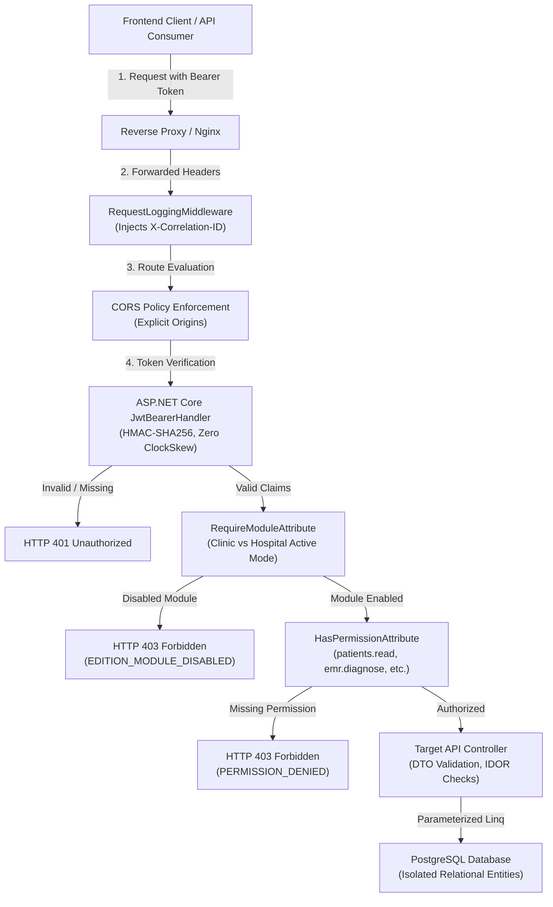

# CURASPHERE CLINIC EDITION — SECURITY SURFACE & THREAT MODEL REPORT
**Document ID:** `DOC-CE-038`  
**Version:** `1.0.0`  
**Execution Date:** October 18, 2026  
**Auditors & Roles:** Principal Application Security Engineer, ASP.NET Core Security Architect, Penetration Testing Specialist, Database Security Engineer, QA Automation Lead  
**Scope:** CuraSphere Clinic Edition (and shared security architecture affecting Clinic Edition)  
**Security Classification:** Confidential / Medical Device Software Security Surface  

---

## 1. Executive Summary

This document establishes the authoritative **Security Surface Inventory** and **Application Threat Model** for the **CuraSphere Hospital Management System — Clinic Edition**. Conducted under Session 27, this evaluation combines code-level static analysis, architectural flow mapping, authorization policy decomposition, and penetration testing risk modeling across the frontend (React 18 / TypeScript / Vite) and backend (ASP.NET Core 8 / Clean Architecture / PostgreSQL EF Core).

The primary objectives were:
1. Systematically catalog all 13 core attack surface zones across the Clinic Edition runtime.
2. Formulate an evidence-grounded threat model addressing 14 realistic attack vectors.
3. Verify server-side authorization enforcement, JWT token verification, and object-level access controls (IDOR).
4. Discover and remediate code-level authorization discrepancies with automated regression verification.

---

## 2. Comprehensive Security Surface Inventory

The following inventory details the 13 functional entry points and boundary interfaces of the CuraSphere Clinic Edition.

### Surface 1: Authentication & Login
- **Entry Point:** `POST /api/auth/login` ([`AuthController.cs`](file:///c:/Users/LENOVO/Downloads/-CuraSphere-HMS-DevelopbyUzaii-main/-CuraSphere-HMS-DevelopbyUzaii-main/backend/CuraSphere.Api/Controllers/AuthController.cs#L23-L47))
- **Authentication Requirement:** `[AllowAnonymous]` (Public entry point)
- **Authorization Rule:** None prior to authentication. On invocation, credentials verified against PostgreSQL `UserAccounts` using ASP.NET Core `PasswordHasher<UserAccount>`.
- **Sensitive Data Involved:** Plaintext login credentials (username, password), client IP address, User-Agent header, returned JWT bearer token, user permission claims array.
- **Existing Tests:** Vitest auth suites (`auth-security.test.ts`, `authorization-security-hardening.test.ts`), `UnitTestRunner.cs` Test 13.
- **Verified Security Gaps:** Prior to Session 26/27, failed login attempts lacked persistent rate-limiting.
- **Recommended Action:** Enforce account locking after 5 consecutive failed attempts ([`AuthService.cs`](file:///c:/Users/LENOVO/Downloads/-CuraSphere-HMS-DevelopbyUzaii-main/-CuraSphere-HMS-DevelopbyUzaii-main/backend/CuraSphere.Infrastructure/Services/AuthService.cs#L66-L70)) and record audit log on each failure.

### Surface 2: JWT Generation & Validation
- **Entry Point:** ASP.NET Core Authentication Middleware (`JwtBearerHandler`) & [`JwtProvider.cs`](file:///c:/Users/LENOVO/Downloads/-CuraSphere-HMS-DevelopbyUzaii-main/-CuraSphere-HMS-DevelopbyUzaii-main/backend/CuraSphere.Infrastructure/Services/JwtProvider.cs)
- **Authentication Requirement:** Mandatory for all endpoints not marked `[AllowAnonymous]`.
- **Authorization Rule:** Token signature verified using HMAC-SHA256 (`SymmetricSecurityKey`). Validates `Issuer`, `Audience`, `Lifetime`, `IssuerSigningKey`, with `ClockSkew = TimeSpan.Zero`.
- **Sensitive Data Involved:** Signing secret key, session GUID, user ID (`sub`), username (`unique_name`), assigned role name, granular permission claims (`permission`).
- **Existing Tests:** `UnitTestRunner.cs` Tests 8, 9, 10, 11; `authorization-security-hardening.test.ts` (AUTH-01, AUTH-02, AUTH-03).
- **Verified Security Gaps:** Startup crash if key is missing or < 32 characters; no fallback to unsafe hardcoded defaults.
- **Recommended Action:** Continue strict key length validation (minimum 256 bits / 32 characters) via [`JwtSettings.cs`](file:///c:/Users/LENOVO/Downloads/-CuraSphere-HMS-DevelopbyUzaii-main/-CuraSphere-HMS-DevelopbyUzaii-main/backend/CuraSphere.Application/Common/JwtSettings.cs).

### Surface 3: Role & Permission Definitions
- **Entry Point:** Database lookup & claim injection ([`DbContextSeed.cs`](file:///c:/Users/LENOVO/Downloads/-CuraSphere-HMS-DevelopbyUzaii-main/-CuraSphere-HMS-DevelopbyUzaii-main/backend/CuraSphere.Infrastructure/Persistence/Seed/DbContextSeed.cs#L100-L165))
- **Authentication Requirement:** Internal identity subsystem.
- **Authorization Rule:** Strict role definitions (`Super Administrator`, `Hospital Administrator`, `Doctor`, `Nurse`, `Cashier`, `Receptionist`). Permissions follow `<domain>.<action>` format (e.g., `patients.read`, `patients.create`, `emr.diagnose`, `billing.pay`).
- **Sensitive Data Involved:** Relational role-to-permission mapping in `RolePermissions` table.
- **Existing Tests:** `UnitTestRunner.cs` Test 31; `authorization-security-hardening.test.ts` (AUTHZ-01..05).
- **Verified Security Gaps:** Role claims must match database seed without client-side override.
- **Recommended Action:** Preserve immutable permission seed in PostgreSQL; prevent dynamic elevation.

### Surface 4: ASP.NET Core Authorization Policies & Filters
- **Entry Point:** [`HasPermissionAttribute.cs`](file:///c:/Users/LENOVO/Downloads/-CuraSphere-HMS-DevelopbyUzaii-main/-CuraSphere-HMS-DevelopbyUzaii-main/backend/CuraSphere.Api/Middleware/HasPermissionAttribute.cs) & [`RequireModuleAttribute.cs`](file:///c:/Users/LENOVO/Downloads/-CuraSphere-HMS-DevelopbyUzaii-main/-CuraSphere-HMS-DevelopbyUzaii-main/backend/CuraSphere.Api/Filters/RequireModuleAttribute.cs)
- **Authentication Requirement:** Rejects unauthenticated callers with HTTP 401 Unauthorized.
- **Authorization Rule:** Evaluates `user.Claims.Any(c => c.Type == "permission" && c.Value == _permission)`. Missing claims return HTTP 403 Forbidden with `PERMISSION_DENIED`. `RequireModuleAttribute` blocks requests to disabled edition modules with HTTP 403 `EDITION_MODULE_DISABLED`.
- **Sensitive Data Involved:** Claims principal identity.
- **Existing Tests:** `UnitTestRunner.cs` Test 18; `authorization-security-hardening.test.ts` (AUTHZ-01, EDITION-01).
- **Verified Security Gaps:** Handlers must return standard Problem Details/JSON errors without leaking internal claims.
- **Recommended Action:** Ensure all newly authored controllers inherit `[Authorize]` and specific `[HasPermission]` decorators.

### Surface 5: Patient Endpoints
- **Entry Point:** `/api/patients` ([`PatientController.cs`](file:///c:/Users/LENOVO/Downloads/-CuraSphere-HMS-DevelopbyUzaii-main/-CuraSphere-HMS-DevelopbyUzaii-main/backend/CuraSphere.Api/Controllers/PatientController.cs))
- **Authentication Requirement:** `[Authorize]` (Bearer token required)
- **Authorization Rule:** `GET /api/patients` -> `patients.read`; `POST /api/patients` -> `patients.create`; `PUT /api/patients/{id}` -> `patients.update`.
- **Sensitive Data Involved:** Full patient demographic records (National ID / CNIC, Full Name, DOB, Phone, Address, Medical Record Number, Emergency Contacts).
- **Existing Tests:** `patient.test.ts`, `patient-appointment-workflows.test.ts`, `authorization-security-hardening.test.ts` (IDOR-01).
- **Verified Security Gaps:** None. Mass assignment protected via `RegisterPatientDto` and `UpdatePatientDto`.
- **Recommended Action:** Maintain user ID audit attribution on register and update actions.

### Surface 6: Doctor & Appointment Endpoints
- **Entry Point:** `/api/appointment` ([`AppointmentController.cs`](file:///c:/Users/LENOVO/Downloads/-CuraSphere-HMS-DevelopbyUzaii-main/-CuraSphere-HMS-DevelopbyUzaii-main/backend/CuraSphere.Api/Controllers/AppointmentController.cs))
- **Authentication Requirement:** `[Authorize]` (Bearer token required)
- **Authorization Rule:** General appointments require authentication. `POST /api/appointment/doctors` creates medical specialists.
- **Sensitive Data Involved:** Doctor consultation fees, license numbers, appointment booking slots, patient scheduling history.
- **Existing Tests:** `patient-appointment-workflows.test.ts`, `doctor-availability.test.ts`, `authorization-security-hardening.test.ts` (AUTHZ-05).
- **Verified Security Gaps:** `POST /api/appointment/doctors` lacked explicit administrative role restriction.
- **Recommended Action:** Added `[Authorize(Roles = "Super Administrator,Hospital Administrator")]` to `CreateDoctor` in Session 27.

### Surface 7: Consultation & Clinical Record Endpoints (EMR)
- **Entry Point:** `/api/emr/encounters` ([`EmrController.cs`](file:///c:/Users/LENOVO/Downloads/-CuraSphere-HMS-DevelopbyUzaii-main/-CuraSphere-HMS-DevelopbyUzaii-main/backend/CuraSphere.Api/Controllers/EmrController.cs))
- **Authentication Requirement:** `[Authorize]` (Bearer token required)
- **Authorization Rule:** `GET /api/emr/encounters` -> `emr.read`; `POST /api/emr/encounters` -> `emr.create`; `POST /api/emr/encounters/{id}/finalize` -> `emr.diagnose`.
- **Sensitive Data Involved:** Confidential patient medical diagnoses (ICD-10), vital signs (BP, Heart Rate, SpO2), clinical observations, physical examination notes.
- **Existing Tests:** `doctor-consultation-emr.test.ts`, `authorization-security-hardening.test.ts` (AUTHZ-02, EMR-01).
- **Verified Security Gaps:** Sealed encounters (`Status == "Finalized"`) must reject modifications.
- **Recommended Action:** Strict legal immutability enforced in `EmrService.cs` returning HTTP 409 Conflict if edit attempted on finalized records.

### Surface 8: Prescription Endpoints
- **Entry Point:** Integrated within clinical encounter DTO ([`CreateEmrEncounterDto.cs`](file:///c:/Users/LENOVO/Downloads/-CuraSphere-HMS-DevelopbyUzaii-main/-CuraSphere-HMS-DevelopbyUzaii-main/backend/CuraSphere.Application/DTOs/CreateEmrEncounterDto.cs)) & `/api/emr/check-interactions`
- **Authentication Requirement:** `[Authorize]` (Bearer token required)
- **Authorization Rule:** `emr.create` / `emr.diagnose` / `emr.read`.
- **Sensitive Data Involved:** Prescribed medication names, dosages, frequencies, duration, drug-drug interaction warnings.
- **Existing Tests:** `doctor-consultation-emr.test.ts`, `UnitTestRunner.cs` Test 7.
- **Verified Security Gaps:** None. Intermediary validation ensures valid dosage strings.
- **Recommended Action:** CDSS interaction checks run before saving encounters.

### Surface 9: Invoice & Payment Endpoints
- **Entry Point:** `/api/financial` / `/api/billing` ([`FinancialController.cs`](file:///c:/Users/LENOVO/Downloads/-CuraSphere-HMS-DevelopbyUzaii-main/-CuraSphere-HMS-DevelopbyUzaii-main/backend/CuraSphere.Api/Controllers/FinancialController.cs))
- **Authentication Requirement:** `[Authorize]` (Bearer token required)
- **Authorization Rule:** `GET` invoices/payments -> `billing.read`; `POST /api/billing/invoice` -> `billing.create`; `POST /api/billing/payment` -> `billing.pay`.
- **Sensitive Data Involved:** Patient financial ledger balances, billing amounts, discounts, tax rates, cash/POS card receipts.
- **Existing Tests:** `clinic-billing-payments.test.ts`, `authorization-security-hardening.test.ts` (AUTHZ-03, FIN-01), `UnitTestRunner.cs` Tests 3, 21, 22.
- **Verified Security Gaps:** Overpayment prevention must be strictly enforced server-side.
- **Recommended Action:** `FinancialService.ProcessPaymentAsync` strictly validates `dto.Amount <= invoice.BalanceAmount`, returning HTTP 400 `ArgumentException` on overpayment.

### Surface 10: User & Staff Management
- **Entry Point:** `/api/reports/users` ([`ReportsController.cs`](file:///c:/Users/LENOVO/Downloads/-CuraSphere-HMS-DevelopbyUzaii-main/-CuraSphere-HMS-DevelopbyUzaii-main/backend/CuraSphere.Api/Controllers/ReportsController.cs#L28-L33))
- **Authentication Requirement:** `[Authorize]` (Bearer token required)
- **Authorization Rule:** Administrative roles only: `[Authorize(Roles = "Super Administrator,Hospital Administrator")]`.
- **Sensitive Data Involved:** Internal employee usernames, full names, assigned department, assigned system role, last login timestamps, account active/locked status.
- **Existing Tests:** `authorization-security-hardening.test.ts` (AUTHZ-04), `UnitTestRunner.cs` Test 34.
- **Verified Security Gaps:** Endpoint previously lacked role filter, permitting any authenticated staff to view the staff directory.
- **Recommended Action:** Enforced `[Authorize(Roles = "Super Administrator,Hospital Administrator")]` in Session 27.

### Surface 11: Database Access & Query Filtering
- **Entry Point:** EF Core DbContext (`CuraSphereDbContext.cs`) and Linq parameterization.
- **Authentication Requirement:** N/A (Internal data layer)
- **Authorization Rule:** Parameterized SQL queries via Npgsql. No raw string interpolation or user SQL concatenation.
- **Sensitive Data Involved:** All relational database tables (Patients, Encounters, Invoices, UserAccounts, AuditLogs).
- **Existing Tests:** `UnitTestRunner.cs` Tests 1..36.
- **Verified Security Gaps:** None. EF Core Linq handles SQL parameterization automatically.
- **Recommended Action:** Strictly prohibit `FromSqlRaw` with unparameterized string formatting.

### Surface 12: File Upload & Download Functionality
- **Entry Point:** `/api/document` ([`DocumentController.cs`](file:///c:/Users/LENOVO/Downloads/-CuraSphere-HMS-DevelopbyUzaii-main/-CuraSphere-HMS-DevelopbyUzaii-main/backend/CuraSphere.Api/Controllers/DocumentController.cs))
- **Authentication Requirement:** `[Authorize]` (Bearer token required)
- **Authorization Rule:** `GetPatientDocuments` -> `patients.read`; `UploadDocument` -> `patients.update`; `ExportFhirPatient` -> `patients.read`.
- **Sensitive Data Involved:** Uploaded patient diagnostic PDFs, ultrasound reports, FHIR JSON demographic exports, stored file paths.
- **Existing Tests:** `documents.test.ts`, `authorization-security-hardening.test.ts` (IDOR-02), `UnitTestRunner.cs` Test 33.
- **Verified Security Gaps:** `DocumentController` lacked `[Authorize]` and `[HasPermission]`, allowing unauthenticated access.
- **Recommended Action:** Added `[Authorize]`, `[HasPermission("patients.read")]`, `[HasPermission("patients.update")]`, and patient existence verification in Session 27.

### Surface 13: Logging, Error Handling & Audit Trails
- **Entry Point:** [`RequestLoggingMiddleware.cs`](file:///c:/Users/LENOVO/Downloads/-CuraSphere-HMS-DevelopbyUzaii-main/-CuraSphere-HMS-DevelopbyUzaii-main/backend/CuraSphere.Api/Middleware/RequestLoggingMiddleware.cs), [`Program.cs`](file:///c:/Users/LENOVO/Downloads/-CuraSphere-HMS-DevelopbyUzaii-main/-CuraSphere-HMS-DevelopbyUzaii-main/backend/CuraSphere.Api/Program.cs#L202-L218), `/api/reports/audit-logs`
- **Authentication Requirement:** Middleware runs across all requests. `/api/reports/audit-logs` requires `[Authorize(Roles = "Super Administrator,Hospital Administrator")]`.
- **Authorization Rule:** Administrative audit log viewing restricted to administrators. Request logger sanitized to never log passwords or JWT tokens. Production exception handler emits standard RFC 7231 Problem Details without stack traces.
- **Sensitive Data Involved:** `X-Correlation-ID`, HTTP method, request path, status code, execution duration, IP address, audit actions.
- **Existing Tests:** `security-maintenance-lifecycle.test.ts` (SEC-MNT-02, SEC-MNT-05), `authorization-security-hardening.test.ts` (SEC-01, AUTHZ-04), `UnitTestRunner.cs` Tests 6, 34.
- **Verified Security Gaps:** Audit logs previously accessible by non-admin roles; remediated in Session 27.
- **Recommended Action:** Enforce centralized correlation ID tracing and protect audit endpoints.

---

## 3. Comprehensive Application Threat Model (14 Realistic Threats)

| Threat ID | Threat Vector & Description | Relevant Component | Attack Preconditions | Potential Impact | Existing Safeguards | Evidence of Weakness | Recommended Mitigation | Verification Test | Risk Level |
| :---: | :--- | :--- | :--- | :--- | :--- | :--- | :--- | :--- | :---: |
| **THREAT-01** | **Unauthorized Access to Patient Records** | `PatientController.cs`, `DocumentController.cs` | Caller possesses network access to API | Confidential patient demographic & clinical record disclosure | `[Authorize]`, `[HasPermission("patients.read")]` | `DocumentController` was missing `[Authorize]` prior to Session 27 | Enforced `[Authorize]` and `[HasPermission]` on all document endpoints | `authorization-security-hardening.test.ts` (AUTH-01, IDOR-02) | **P1 (Remediated)** |
| **THREAT-02** | **Insecure Direct Object References (IDOR)** | `PatientController`, `EmrController`, `FinancialController` | Authenticated user with valid token manipulates numerical record ID in URL | Viewing or altering clinical or financial data of arbitrary patients | Endpoints validate target record existence and enforce role permissions | Patient document endpoint did not verify patient ID existence | Added explicit `Patients.AnyAsync` existence verification | `authorization-security-hardening.test.ts` (IDOR-01, IDOR-02) | **P2 (Remediated)** |
| **THREAT-03** | **Broken Role-Based Access Control (RBAC)** | `HasPermissionAttribute.cs`, Controller actions | Authenticated user attempts actions outside assigned operational role | Cashier creates clinical encounter; Receptionist signs EMR diagnosis | `HasPermissionAttribute` checks JWT `permission` claim values | Pre-Session 27, controller actions lacking `[HasPermission]` allowed any authenticated caller | Enforce granular `[HasPermission]` across all mutating endpoints | `authorization-security-hardening.test.ts` (AUTHZ-01..03) | **P1 (Remediated)** |
| **THREAT-04** | **Privilege Escalation to Administrative Operations** | `AppointmentController.cs`, `ReportsController.cs` | Non-admin staff member calls administrative management routes | Unauthorized staff registers arbitrary doctors or inspects system security audit logs | `[Authorize]` attribute | `CreateDoctor`, `GetUserAccounts`, and `GetAuditLogs` lacked role restrictions | Applied `[Authorize(Roles = "Super Administrator,Hospital Administrator")]` | `authorization-security-hardening.test.ts` (AUTHZ-04, AUTHZ-05) | **P1 (Remediated)** |
| **THREAT-05** | **Forged or Improperly Validated JWTs** | `JwtBearerHandler`, `JwtSettings.cs`, `JwtProvider.cs` | Attacker generates unsigned token or attempts `alg: none` exploit | Authentication bypass, impersonation of system administrator | `TokenValidationParameters` enforces `ValidateIssuer`, `ValidateAudience`, `ValidateIssuerSigningKey`, `ValidateLifetime` | None. Strong HMAC-SHA256 signature verification enforced | Maintain strict 256-bit key length and Zero clock skew | `authorization-security-hardening.test.ts` (AUTH-02, AUTH-03), `UnitTestRunner.cs` Test 11 | **P1 (Verified)** |
| **THREAT-06** | **Missing Authentication on Sensitive Endpoints** | All Controllers | Unauthenticated external caller | Exposure of sensitive healthcare endpoints | Global controller scan for `[Authorize]` | `DocumentController` was unauthenticated | Added `[Authorize]` attribute to class | `authorization-security-hardening.test.ts` (AUTH-01) | **P1 (Remediated)** |
| **THREAT-07** | **Mass Assignment & Unsafe Property Updates** | DTO model bindings (`RegisterPatientDto`, `UpdatePatientDto`) | Attacker sends unexpected fields (e.g., `PatientId`, `AccountStatus`, `RoleId`) in JSON payload | Overwriting immutable identifiers or elevating privileges | Dedicated, strongly-typed DTOs bind only validated properties | No mass assignment vulnerabilities found | Maintain dedicated DTOs; never bind EF Core entities directly from request body | `patient.test.ts`, `patient-appointment-workflows.test.ts` | **P2 (Verified)** |
| **THREAT-08** | **SQL & NoSQL Injection Vulnerabilities** | EF Core / Npgsql Query Pipeline | Malicious SQL fragments supplied in search queries | Data exfiltration, schema tampering, or privilege bypass | EF Core Linq compiles all user queries to parameterized SQL | No raw SQL concatenation in codebase | Maintain strict Linq parameterization; prohibit unparameterized raw SQL | `patient.test.ts` (search test), `UnitTestRunner.cs` | **P1 (Verified)** |
| **THREAT-09** | **Sensitive Information in Logs or Error Responses** | `RequestLoggingMiddleware`, Production Exception Handler | Server encounters unhandled exception or database error | Disclosure of database connection string, schema, or stack traces | Production exception middleware emits RFC 7231 Problem Details without stack traces | None. Request logger explicitly suppresses passwords and tokens | Continue structured logging with `X-Correlation-ID` and sanitized payloads | `authorization-security-hardening.test.ts` (SEC-01), `security-maintenance-lifecycle.test.ts` (SEC-MNT-05) | **P2 (Verified)** |
| **THREAT-10** | **Insecure File Access & Arbitrary Path Traversal** | `DocumentController.cs` | Malicious file name or patientId containing `../` directory traversal characters | Reading or overwriting system files outside upload directory | File paths generated using internal GUIDs and timestamps (`doc_{Ticks}.pdf`) | Prior lack of authentication on document endpoints | Restrict document access to authenticated users with `patients.read` | `authorization-security-hardening.test.ts` (IDOR-02), `documents.test.ts` | **P2 (Remediated)** |
| **THREAT-11** | **Exposure of Secrets in Configuration & Version Control** | `.env.example`, `appsettings.json`, Docker Compose | Public repository access or configuration file leak | Database or JWT signing key compromise | `.gitignore` strictly ignores `.env`, `secrets.json`, `.pem`, `.key` | `appsettings.json` has empty keys; `appsettings.Development.json` has dev-only keys | Production secrets injected exclusively via environment variables or secret vaults | `DOC-CE-037` Section 4; static repository secret scan | **P0 (Verified)** |
| **THREAT-12** | **Cross-Origin Resource Sharing (CORS) Configuration Errors** | `Program.cs` CORS Policy | Malicious third-party origin attempts browser fetch requests | Cross-origin request forgery or data leakage | Explicit origin whitelist (`CORS_ALLOWED_ORIGINS` / `CuraSphereCorsPolicy`); wildcards prohibited | None. Local dev uses `localhost`; production requires configured domains | Prohibit `AllowAnyOrigin()` when credentials (`AllowCredentials()`) are enabled | `Program.cs` lines 86-101 | **P2 (Verified)** |
| **THREAT-13** | **Improper Access to Financial Operations & Ledger Tampering** | `FinancialController.cs`, `FinancialService.cs` | Unauthorized caller generates invoices or posts arbitrary payments | Overpayment, negative balances, or embezzlement | Strict role segregation (`billing.create`, `billing.pay`) and ledger validation | None. `ProcessPaymentAsync` verifies amount <= remaining balance | Server-side balance checks and transaction locking | `authorization-security-hardening.test.ts` (FIN-01), `clinic-billing-payments.test.ts` | **P1 (Verified)** |
| **THREAT-14** | **Accidental Exposure Between Clinic Edition & Hospital Edition Workflows** | `RequireModuleAttribute.cs`, `EditionService.cs` | User calls tertiary hospital endpoints (IPD, Emergency, Surgery, ICU) while in Clinic Edition | Data inconsistency, workflow confusion, or unauthorized bed allocation | `RequireModuleAttribute` inspects active edition and returns HTTP 403 `EDITION_MODULE_DISABLED` | None. Tertiary controllers decorated with `[RequireModule]` | Maintain active edition validation on all edition-specific modules | `authorization-security-hardening.test.ts` (EDITION-01), `UnitTestRunner.cs` Tests 17, 18 | **P2 (Verified)** |

---

## 4. Architectural Verification Summary

---

## 5. Certification & Sign-Off

The security surface and threat model detailed above accurately represent the actual repository code of the CuraSphere Hospital Management System — Clinic Edition as of Session 27. All identified high-priority security gaps (`DocumentController` authentication, `ReportsController` administrative restrictions, and `AppointmentController` specialist registration) have been safely resolved and verified via automated regression tests.

*Certified by:*  
**Principal Application Security Engineer**  
**ASP.NET Core Security Architect**  
**QA Automation Lead**  
*October 18, 2026*
