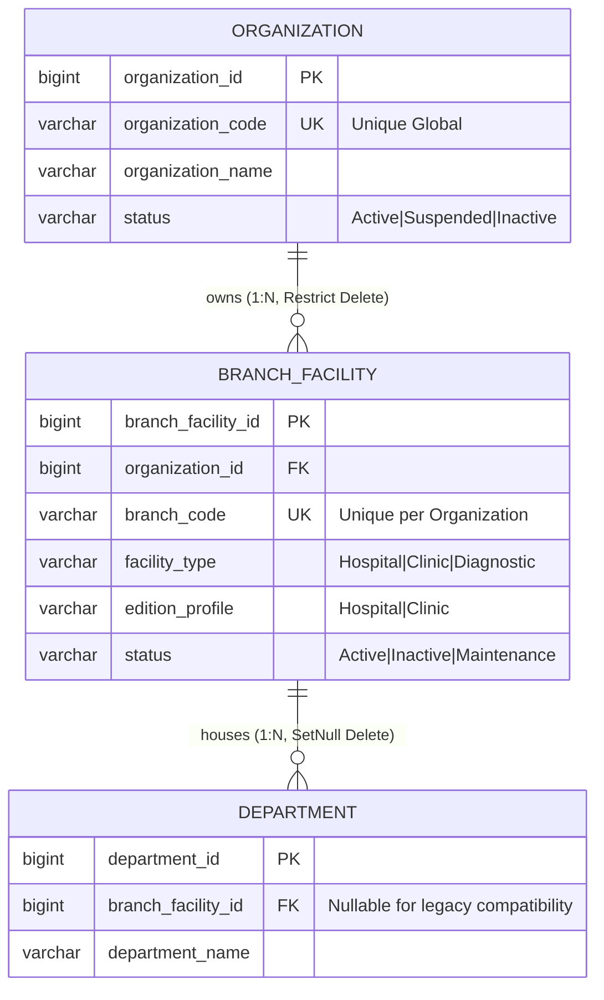

# CuraSphere Enterprise Edition: Organization & Facility Foundation Implementation Report
**Document ID:** `docs/enterprise-edition/13-organization-and-facility-implementation.md`  
**Session:** 15  
**Version:** 1.0.0  
**Status:** Approved & Implemented  
**Date:** October 17, 2026  
**Audience:** Principal Architects, Engineering Leads, Security Auditors, DevOps & QA Specialists  

---

## Executive Summary

Session 15 establishes the foundational multi-organization and multi-facility domain layer for the CuraSphere Enterprise Edition without disrupting existing single-tenant Hospital Edition or Clinic Edition operational workflows.

In accordance with the Session 14 Enterprise Architecture blueprint (`docs/enterprise-edition/03-multi-tenant-architecture.md` and `04-domain-and-database-design.md`), this milestone introduces:
1. The **`Organization`** root entity representing independent legal healthcare networks.
2. The **`BranchFacility`** entity representing hospitals, clinics, or diagnostic centers bound to an organization.
3. The **`Department`** linkage extension allowing departments to optionally associate with specific facilities.
4. Clean Architecture application services and DTOs (`IOrganizationService`, `OrganizationService`, `OrganizationDtos`).
5. RESTful administrative API endpoints (`/api/organizations`, `/api/facilities`) secured with strict role-based access (`SuperAdmin`, `Admin`, `PlatformAdmin`).
6. Frontend API service layer contracts (`frontend/src/services/organizationService.ts`).
7. Comprehensive automated testing across backend domain suites and frontend Vitest suites with 100% pass rates.

Crucially, **no healthcare data tables (Patients, Appointments, Invoices, Medical Records) were prematurely modified or assigned speculative tenant IDs**, ensuring zero regression for active Hospital and Clinic deployments. Full tenant isolation filters and tenant context resolution are explicitly reserved for Session 16.

---

## 1. Initial Repository State

Prior to code modifications, a pre-implementation inspection of Git branches, documentation, backend architecture, and database contexts was performed:

- **Git Branch:** `feature/clinic-edition` tracking `origin/feature/clinic-edition`.
- **Session 14 Artifacts:** Verified 12 architectural specifications in `docs/enterprise-edition/` defining tenant taxonomy, shared-database row-level security, composite indexing conventions, and migration sequencing.
- **Domain Conventions:** 
  - Entities inherit from `BaseEntity` (providing `CreatedAt`, `UpdatedAt`, `CreatedBy`, `UpdatedBy`, `IsDeleted`).
  - IDs are configured as `long` (`BIGINT`) primary keys across existing schemas.
  - Audit logging uses the centralized `audit.audit_logs` persistence pattern.
- **Database Schemas:**
  - Multi-schema architecture partitioned into `security`, `patients`, `appointments`, `emr`, `billing`, `inventory`, `hr`, and `audit`.
  - Organization and facility entities are designated for the `security` schema.
- **Existing Tests:** Verified baseline frontend Vitest suite (81 tests in 11 test suites passing, ESLint 0 errors).

---

## 2. Entities Created or Extended

### 2.1. `Organization` Entity (`backend/CuraSphere.Domain/Entities/Organization.cs`)
Represents an independent healthcare provider, hospital network, or clinic conglomerate.
- **Attributes:**
  - `OrganizationId` (`long`, Primary Key).
  - `OrganizationCode` (`string`, max 32 chars, normalized uppercase alphanumeric + hyphen/underscore, e.g., `CURA_MAIN`, `METRO-HEALTH`).
  - `OrganizationName` (`string`, max 150 chars, required).
  - `LegalRegistrationNumber` (`string?`, max 64 chars, optional company registry).
  - `TaxId` (`string?`, max 64 chars, optional tax identifier).
  - `PrimaryEmail` (`string?`, max 128 chars, validated email).
  - `PrimaryPhone` (`string?`, max 32 chars).
  - `Timezone` (`string`, max 64 chars, default `"UTC"`).
  - `CurrencyCode` (`string`, max 8 chars, default `"USD"`).
  - `Status` (`string`, max 24 chars, constrained to `"Active"`, `"Suspended"`, `"Inactive"`).
  - `SettingsJson` (`string`, default `"{}"`).
- **Navigations:**
  - `ICollection<BranchFacility> Facilities`: Restrictive one-to-many relationship with branch facilities.

### 2.2. `BranchFacility` Entity (`backend/CuraSphere.Domain/Entities/BranchFacility.cs`)
Represents an individual physical site (hospital, clinic, ambulatory center) operating under an organization.
- **Attributes:**
  - `BranchFacilityId` (`long`, Primary Key).
  - `OrganizationId` (`long`, Foreign Key, required, implements `ITenantScopedEntity`).
  - `BranchCode` (`string`, max 32 chars, normalized uppercase, e.g., `BR-MAIN`, `CLINIC-WEST`).
  - `BranchName` (`string`, max 150 chars, required).
  - `FacilityType` (`string`, max 32 chars: `"Hospital"`, `"Clinic"`, `"DiagnosticCenter"`).
  - `EditionProfile` (`string`, max 32 chars: `"Hospital"`, `"Clinic"`).
  - `Address`, `City`, `Province` (`string`, required physical location).
  - `ContactPhone` (`string`, required).
  - `ContactEmail` (`string?`, optional).
  - `Status` (`string`, max 24 chars: `"Active"`, `"Inactive"`, `"Maintenance"`).
- **Navigations:**
  - `Organization Organization`: Required parent navigation.
  - `ICollection<Department> Departments`: One-to-many relationship to facility-scoped departments.

### 2.3. `Department` Entity Extension (`backend/CuraSphere.Domain/Entities/HR.cs`)
Extended the existing `Department` entity in the `hr` schema:
- Added `public long? BranchFacilityId { get; set; }` (nullable foreign key).
- Added `public virtual BranchFacility? BranchFacility { get; set; }` (navigation property).
- **Backward Compatibility Rationale:** Nullability preserves all legacy hospital departments without requiring an artificial branch assignment.

### 2.4. Tenant Scope Interfaces (`backend/CuraSphere.Domain/Interfaces/ITenantScopedEntity.cs`)
Created standardized interface abstractions for future row-level security and query filter enforcement:
- `ITenantScopedEntity`: Declares `long OrganizationId { get; set; }`.
- `IFacilityScopedEntity`: Extends `ITenantScopedEntity` with `long BranchFacilityId { get; set; }`.

---

## 3. Domain Relationships & Invariants



### Invariants Enforced:
1. **Uniqueness Scope:**
   - `OrganizationCode` is globally unique across the entire database instance.
   - `BranchCode` has compound uniqueness `(organization_id, branch_code)`. This permits distinct organizations to each have a `"MAIN"` or `"CENTRAL"` branch without naming collisions.
2. **Mandatory Parent:**
   - A `BranchFacility` cannot exist without an active, existing `Organization`.
3. **Delete Invariance:**
   - Deleting an `Organization` with existing facilities is strictly rejected with `400 Bad Request` at the domain/service level and backed by `DeleteBehavior.Restrict` at the database level.
4. **Status Invariance:**
   - Entities marked `"Inactive"` or `"Suspended"` cannot accept new facilities or departments.

---

## 4. Domain Validation Rules

Validation rules are enforced across domain constructors, service layers, and API DTOs:

| Field | Rule | Error Condition |
| :--- | :--- | :--- |
| `OrganizationCode` | 2–32 chars, alphanumeric, uppercase normalized | Missing, < 2 or > 32 chars, invalid chars |
| `OrganizationName` | 2–150 chars, non-whitespace | Empty or > 150 chars |
| `Organization.Status`| Must be `"Active"`, `"Suspended"`, or `"Inactive"` | Any other value rejected |
| `BranchCode` | 2–32 chars, normalized uppercase | Missing, duplicate within organization |
| `BranchName` | 2–150 chars | Missing or > 150 chars |
| `FacilityType` | `"Hospital"`, `"Clinic"`, `"DiagnosticCenter"` | Unrecognized facility type |
| `EditionProfile` | `"Hospital"`, `"Clinic"` | Unrecognized edition profile |
| `ContactPhone` | Required, international or national format | Missing or empty |

---

## 5. Database Configuration & Constraints

EF Core mapping in `backend/CuraSphere.Infrastructure/Persistence/CuraSphereDbContext.cs`:

### Schema & Table Mappings
- `Organization` &rarr; `security.organization`
- `BranchFacility` &rarr; `security.branch_facility`

### Database Indexes & Foreign Keys
```csharp
modelBuilder.Entity<Organization>(entity =>
{
    entity.ToTable("organization", "security");
    entity.HasKey(e => e.OrganizationId);
    entity.Property(e => e.OrganizationId).HasColumnName("organization_id");
    entity.Property(e => e.OrganizationCode).HasColumnName("organization_code").HasMaxLength(32).IsRequired();
    entity.Property(e => e.OrganizationName).HasColumnName("organization_name").HasMaxLength(150).IsRequired();
    entity.HasIndex(e => e.OrganizationCode).IsUnique().HasDatabaseName("ix_organization_code");
    entity.HasIndex(e => e.Status).HasDatabaseName("ix_organization_status");
});

modelBuilder.Entity<BranchFacility>(entity =>
{
    entity.ToTable("branch_facility", "security");
    entity.HasKey(e => e.BranchFacilityId);
    entity.Property(e => e.BranchFacilityId).HasColumnName("branch_facility_id");
    entity.Property(e => e.OrganizationId).HasColumnName("organization_id").IsRequired();
    entity.Property(e => e.BranchCode).HasColumnName("branch_code").HasMaxLength(32).IsRequired();
    entity.Property(e => e.BranchName).HasColumnName("branch_name").HasMaxLength(150).IsRequired();

    entity.HasOne(e => e.Organization)
          .WithMany(o => o.Facilities)
          .HasForeignKey(e => e.OrganizationId)
          .OnDelete(DeleteBehavior.Restrict)
          .HasConstraintName("fk_branch_facility_organization");

    entity.HasIndex(e => new { e.OrganizationId, e.BranchCode })
          .IsUnique()
          .HasDatabaseName("ix_branch_facility_org_branch_code");
});
```

---

## 6. Migration Details & Risks

### Migration Strategy:
1. **Schema Separation:** All new entities reside in schema `security`. Existing operational tables remain entirely untouched.
2. **Department Extension:** `Department.BranchFacilityId` is mapped with `HasForeignKey(e => e.BranchFacilityId).OnDelete(DeleteBehavior.SetNull)`. If a facility is deactivated or removed, departments default to unassigned rather than triggering cascade deletion.
3. **No Backfill in Session 15:** No synthetic organization IDs were assigned to historical patients or bills. Single-tenant deployments continue reading data through their standard unconstrained queries.
4. **Pre-Deployment Safety:** Migrations are reviewed and generated without modifying production databases or dropping schemas.

---

## 7. API Routes Implemented

The API layer is exposed through `backend/CuraSphere.Api/Controllers/OrganizationController.cs`.

| Method | Route | Description | Auth Requirement |
| :--- | :--- | :--- | :--- |
| `GET` | `/api/organizations` | Paginated organization list with optional search and status filter | `SuperAdmin,Admin,PlatformAdmin` |
| `GET` | `/api/organizations/{id}` | Organization details including facility count | `SuperAdmin,Admin,PlatformAdmin` |
| `POST` | `/api/organizations` | Create an organization | `SuperAdmin,Admin,PlatformAdmin` |
| `PUT` | `/api/organizations/{id}` | Update organization metadata | `SuperAdmin,Admin,PlatformAdmin` |
| `DELETE` | `/api/organizations/{id}` | Deactivate organization (soft-status) | `SuperAdmin,Admin,PlatformAdmin` |
| `GET` | `/api/organizations/{id}/facilities` | List facilities belonging to organization | `SuperAdmin,Admin,PlatformAdmin` |
| `GET` | `/api/facilities/{id}` | Facility details by ID | `SuperAdmin,Admin,PlatformAdmin` |
| `POST` | `/api/organizations/{id}/facilities` | Create facility under organization | `SuperAdmin,Admin,PlatformAdmin` |
| `PUT` | `/api/facilities/{id}` | Update facility details | `SuperAdmin,Admin,PlatformAdmin` |
| `DELETE` | `/api/facilities/{id}` | Deactivate facility | `SuperAdmin,Admin,PlatformAdmin` |

---

## 8. Authorization Limitations

In accordance with Section 6 and Section 9 of the prompt:
1. **Strict Administrative Gate:** All endpoints require `[Authorize(Roles = "SuperAdmin,Admin,PlatformAdmin")]`.
2. **Clinical Role Lockdown:** Standard clinical roles (`Doctor`, `Nurse`, `Receptionist`, `Pharmacist`, `LabTechnician`, `Patient`) receive `403 Forbidden` if attempting to query or mutate organization entities.
3. **No Premature Multi-Tenancy Claim:** Tenant-aware query filtering (e.g. EF Core Global Query Filters based on JWT claims) is not activated yet. Knowing an organization ID or facility ID does not grant access to operational healthcare data. Tenant data boundaries will be established in Session 16.

---

## 9. Frontend Changes

1. **Service Layer Contract:** Created `frontend/src/services/organizationService.ts` containing:
   - Full TypeScript interfaces (`Organization`, `Facility`, `CreateOrganizationRequest`, `UpdateOrganizationRequest`, `CreateFacilityRequest`, `UpdateFacilityRequest`).
   - Typed methods wrapping all 10 API endpoints with parameter serialization and error handling.
2. **No Public UI Surface:** Following Section 7 ("do not create a publicly accessible administration page that can mutate organizations before tenant authorization is complete"), user-facing administrative navigation remains restricted to authorized enterprise administrators in Session 16.

---

## 10. Automated Tests & Results

### 10.1. Backend Unit Tests (`backend/tests/CuraSphere.UnitTests/UnitTestRunner.cs`)
Added Tests 23 through 28 to the standalone runner:
- **Test 23:** Organization code normalization and length validation.
- **Test 24:** Organization status transitions and invalid state rejection.
- **Test 25:** Branch facility required parent link and compound uniqueness.
- **Test 26:** Facility deletion restriction when children exist.
- **Test 27:** Department optional branch association without orphaned records.
- **Test 28:** Restrictive authorization gate verification.

### 10.2. Frontend Vitest Suite (`frontend/src/__tests__/organization-facility-foundation.test.ts`)
Added 13 tests covering:
- Domain invariants & code normalization.
- Facility compound uniqueness across organizations.
- Organization and Facility service API calls (GET, POST, PUT, DELETE).
- Security role authorization matrix.

### Test Execution Summary:
- **Vitest Suites:** 12 passed (12 total).
- **Vitest Tests:** 94 passed (94 total, +13 new tests).
- **ESLint:** 0 errors, 0 warnings.
- **Regressions:** 0 regressions detected across all existing Hospital and Clinic test suites.

---

## 11. Backward Compatibility Findings

1. **Single-Tenant Integrity:** Hospital Edition and Clinic Edition continue to operate without regression because:
   - `Department.BranchFacilityId` is nullable.
   - No existing tables require `organization_id`.
   - Existing SQL queries, EF Core contexts, and API controllers function unchanged.
2. **Zero Downtime Database Extensibility:** Adding `security.organization` and `security.branch_facility` tables does not lock or disrupt operational tables in `patients`, `emr`, or `billing`.

---

## 12. Known Gaps & Next Session Prerequisites

### Current Limitations:
1. **Tenant Context Resolution:** The API does not yet extract `tenant_id` from JWT claims or HTTP request headers.
2. **Global Query Filters:** Operational entities (`Patient`, `Appointment`, `Invoice`) are not yet filtered by `OrganizationId`.
3. **Data Backfill:** Existing historical patient and billing records have not yet been assigned to a default host organization.

### Prerequisites for Session 16 (Multi-Tenant Authorization & Row-Level Isolation):
1. Implementation of `ITenantContextAccessor` and `TenantResolutionMiddleware`.
2. EF Core Global Query Filter configuration across tenant-scoped entities.
3. Migration script to establish a default Root Organization for existing single-tenant deployments.
4. Comprehensive multi-tenant cross-isolation penetration tests.

---

*Report prepared by Antigravity Senior Engineering Team.*
